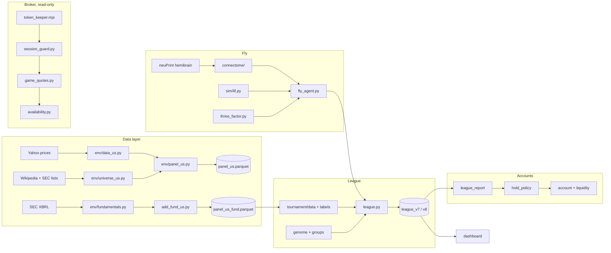

# PROJECT HANDOVER (CURRENT): fly-trader / STONKFLY

**Document status (2026-11-27): COMPLETE. Stages 1-10 done; sections 1-19 written; section 20 records the final verification. Updated with the user's `more_out.txt` (see Appendix A, "Update U9").**
**Lab update (2026-11-27, later the same day):** V4 (daily runner), V5 (website order bot), the fly's autopilot and the dashboard trade view were built and tested on a lab PC; see section 21 and `LAB_SESSION_HANDOVER.md` (the full record). Sections 1, 4, 5, 10, 14, 17, 18 and 19 were updated for it; where they disagree with Appendix A, these sections win.
Appendix A holds the detailed working notes from Stages 1-8 (audit evidence, tables, raw git facts). Where this document and the appendix differ, this document (written later) wins; known differences are listed in section 15.
Evidence labels: **[verified]** = seen in code, a test or a run output; **[stated]** = the user said it; **[discussed]** = proposed, not run; **[unverified]** = not checked.
Rules for anyone editing this file: never write secrets here; never claim something works because code exists.

## Contents

1 Executive overview - 2 Current objectives - 3 Development history - 4 Implementation status - 5 GitHub - 6 Local directory structure - 7 Important files - 8 Architecture - 9 Dependencies and installation - 10 Configuration - 11 APIs, datasets, services - 12 Algorithms - 13 Testing - 14 Known bugs - 15 Local vs GitHub - 16 Abandoned approaches and lessons - 17 Outstanding tasks - 18 Roadmap - 19 Instructions for the next AI - Appendix A (working notes, Stages 1-8)

---

## 1. Executive project overview

**STONKFLY / fly-trader** is a research project that wires the real fruit-fly mushroom-body connectome (hemibrain, via neuPrint) into a leaky integrate-and-fire simulator and uses the circuit's output as a **stock-ranking score**. A "league" of flies is trained on past dates, ranked, culled and bred. A long-only simulated account with an ETF core, a hold policy and liquidity-aware costs turns scores into trades. A live 3D dashboard shows the league (finished; do not change it).

**Honest result so far [verified]:** no tradable edge. On every test the fly performs about like ridge regression and a one-day-reversal rule (rank IC about +0.01); nothing survives multiple-testing correction; selection among flies is mostly luck; the 9 new SEC fundamentals failed a pre-registered screen. The untouched final holdout (last 500 dates) has **not** been used and **must not be** (`--final`).

**Current direction:** run the machinery on a play-money service, the **Investopedia Trading Game** (public default game, $100,000, no end date, no commission, 20-minute delay), from the user's PC now and a Raspberry Pi 4 later. **Since the lab session (section 21):** the fly runs a whole trading day by itself (`python -m broker.autopilot`): it reads its account on the website, refreshes data, scores the S&P 500 with the league_v8 committee, plans one hold-policy day, and places its orders through the Trade tab in a visible Edge window. Every real-site run so far was **preview only: no order has ever been submitted** [verified]. The submit step is tested only on a local stand-in page.

## 2. Current objectives [stated]

1. Universe: all US common stocks on NYSE, Nasdaq and NYSE American (the TSX and commissions were dropped).
2. Learn exits instead of hard-coding them; richer data (the 9 extra fundamentals were tried and rejected).
3. **End goal:** the fly trades the Investopedia game automatically through the library's API ("i want the api to do what it says"), long-only and cash-only, choosing only stocks the game offers.
4. Process rules: small parts; send each file with a one-line caption and the exact destination folder; stop and wait for "go"; the user pushes from their own clone; never run `--final`; never send the user's email to external services without approval; Investopedia credentials and session files stay on the user's machine and out of git.

## 3. Development history (short; detail in 8.1 of Appendix A)

| Dates (2026) | Phase |
|---|---|
| Oct 28 - Nov 9 | Foundation: neuPrint fetch, KC-MBON tuning, learnability on planted momentum, TSX dataset, Stage 0 evolution, panel fly and ridge, league v6, SEC point-in-time fundamentals, S&P 500 universe, evaluation suite, README |
| Nov 14 - 20 | 3D dashboard; T-track: account rules, top-K policy, hold policy, ETF core floor, MIX preset, controls, rules-vs-flies, fundamentals audit, hybrid panel, sector-neutral labels |
| Nov 21 - 22 | A-track diagnoses (sell quality, blends, horizons, selection noise); v8 diverse league; F-track richer fundamentals (rejected) |
| Nov 23 - 24 | U-track: US-wide universe, prices, liquidity, chunked panel, SEC fundamentals, liquidity costs (U5), baselines (U6) |
| Nov 24 - 27 | V-track: Investopedia rules, probe, login attempts, browser bridge, game-only quotes, availability check; this handover |

## 4. Current implementation status

| Component | Status | Evidence |
|---|---|---|
| Connectome fetch and loader | done | code; fetch needs `NEUPRINT_TOKEN`; not unit tested |
| Fly (`FlyAgent`, LIF, three-factor rule) | done | exercised via league tests [verified in tests]; no skill shown on real data |
| League v7 and diverse v8 | done, run on the **S&P 500 hybrid panel** | user-run outputs; `league_v7/`, `league_v8/` |
| Point-in-time S&P 500 and SEC data (11 fundamentals) | done | tests and audits |
| Big US universe pipeline U1-U4 | done | user-run outputs (4,680 tradable names, 10.3M panel rows, 3,694 companies with SEC data) |
| Long-only account, hold policy (MIX), ETF core | done | tests |
| Liquidity costs and volume cap (U5) | done | tests (`test_liquidity`) |
| Baselines on the US panel (U6) | done | user-run output; result: nothing beats chance |
| 3D dashboard | done; **do not change** | PC only for parts (`dashboard3d/`) |
| Investopedia read access (portfolio, quotes, availability) | works live for reads | user-run probe outputs; 50 of 50 stocks checked |
| Availability for all ~4,630 stocks | **not run** (about 2.5 h) | proposed; every symbol the website bot touched existed in the game |
| V4 daily runner (scores + availability + rules -> order list) | **done** (lab): `broker/daily_run.py`, `accounts/order_plan.py`, `tournament/live*.py`, `accounts/policy_state.py` | tests; real runs (section 21) |
| V5 order placement | **built** (lab): `broker/trade_ui.py` (website, Playwright + Edge); **no real submit yet** | stand-in page tests; real-site preview runs |
| The fly's autopilot (whole day, unattended) | **built** (lab): `broker/autopilot.py`, `broker/site_account.py`, `run_autopilot.cmd` | real-site preview run |
| Dashboard trade view | **built** (lab): `--trade-feed`, 4th monitor with the fly's browser | tests, self-test, hidden-window renders |
| Raspberry Pi runner | **not started** | |
| Investopedia terms of service | **read** (lab); they forbid bots/scrapers; the user chose to go ahead (section 21) | `LAB_SESSION_HANDOVER.md` section 6 |
| Tests | 274 on the PC (2026-11-26); **364 passed on the lab PC** after the lab work (2026-11-27) | pytest output |
| Backup | lab work pushed to GitHub as branch **`lab-work`**; the older post-U2 home work is still **not on GitHub** | `git ls-remote` |

## 5. GitHub repository information

| Item | Value |
|---|---|
| Repository | `https://github.com/tanker-bit/fly-trader` (public) |
| Branches | `main` = `bc2fa85` (2026-11-19, 34 commits); `trading-t1-account` = `cec8e1a` (2026-11-23, 50 commits, ends at **U2**) |
| Working branch | `trading-t1-account` (the user's PC clone is level with GitHub: 0 ahead, 0 behind) |
| Lab branch | **`lab-work`** on GitHub (pushed 2026-11-27): the lab session's commits on top of `cec8e1a`; merge it into `trading-t1-account` at home (`LAB_SESSION_HANDOVER.md` section 3) |
| Local `main` ahead by 1 | PC `main` = `d73f783` "Hold policy mix ..." is 1 commit ahead of `origin/main`, **but it is already on GitHub**: `git branch -a --contains d73f783` lists local `main`, local `trading-t1-account` and `origin/trading-t1-account` [verified 2026-11-27]. Nothing is lost; `origin/main` is simply stale |
| Tags, releases | none; issues, PRs, Actions: **unverified** (API not reachable) |
| Default branch | unverified (probably `main`) |
| History start | 2026-10-28 (first dataset was TSX); authors: `tanker-bit` (35) and the user's name (15) |
| Not on GitHub | all of U3-U6, V1-V3, U5 code, 7 modified tracked files, and this handover |
| Third-party library | `dchrostowski/investopedia_simulator_api`, a separate repo cloned at `D:\github\investopedia_simulator_api`, not part of this repo |
| Sandbox clone | `/home/claude/tanker-bit/fly-trader`: shallow, different history, **cannot push**; the PC clone is the source of truth |

## 6. Local directory structure (user's PC; project root `D:\github\fly-trader\fly-trader`, 13,816 files, 5.77 GB)

```
D:\github\
  fly-trader\
    .venv\                      project Python environment (outside the repo)
    fly-trader\                 <- git repository root (the real project)
      accounts\  baselines\  broker\  connectome\  dashboard\  dashboard3d\  docs\
      env\  evalkit\  evolution\  experiments\  learning\  sim\  tournament\  tests\
      reports\  previews\  results\ (ignored)  handover\ (ignored)
      data\ (ignored: TSX-era files, likely the neuPrint csv files)
      data_fundamentals\ (ignored, 2.98 GB)   data_us\ (2.70 GB, NOT ignored)
      league_data\, league_data_fundamentals\ (ignored)   league_v7\, league_v8\
      README.md  requirements.txt  .gitignore  .env (ignored)  39 root files incl. result csvs
    fly-trader-local\           unused backup copy; ignore (user will delete)
    local_audit.txt  .pytest_cache
  investopedia_simulator_api\   third-party library, own git repo, own .venv
    token_keeper.mjs  (the bridge; only copy)   bridge_key.txt, browser_profile\ ... (live login: keep private)
  audit_local.py   New folder\ (old handover zip and doc; user will delete)
```

| Directory | Contents (files) |
|---|---|
| `accounts/` (10) | account, hold policy, instruments/ETFs, liquidity (U5), sim, league report, rebuild_scores |
| `broker/` (5 in sandbox) | session_guard, game_quotes, availability, probe_investopedia |
| `connectome/` (3) | neuPrint fetch and loader |
| `env/` (10) | prices, features, SEC fundamentals, US universe, panel builder, portfolio, gym env |
| `evalkit/` (4), `baselines/` (2) | honest statistics; buy-and-hold |
| `evolution/` (5) | Stage 0 loop on synthetic data (superseded) |
| `learning/` (4), `sim/` (2) | fly agent, three-factor rule, ridge; LIF simulator |
| `tournament/` (8) | league, labels, genome, groups, data, store, summary |
| `experiments/` (55 .py) | data builders, evaluations, diagnostics, league entry, old fly experiments, dashboard entry |
| `dashboard/` (8), `dashboard3d/` (8) | live league dashboard (do not change) |
| `tests/` (51 on the PC, 48 in the sandbox) | pytest files |
| `docs/` (2) | Investopedia rules sheet and library notes |

## 7. Important files

| File | Why it matters |
|---|---|
| `learning/fly_agent.py`, `sim/lif.py`, `learning/three_factor.py` | the fly itself |
| `tournament/league.py` (452 lines), `genome.py`, `groups.py`, `labels.py`, `data.py` | the league, labels (`5+21+63`, sector-neutral), splits and gap |
| `env/panel_us.py`, `env/fundamentals.py` (405 lines), `env/universe_us.py` | big US panel, point-in-time SEC data, membership |
| `accounts/account.py`, `hold_policy.py`, `liquidity.py` | trading rules, policy, costs |
| `experiments/baseline_us.py` | the key honest baseline on 2,000 stocks (U6) |
| `experiments/run_league.py` | league entry (`--final` = one-time holdout test, **never run**) |
| `broker/session_guard.py`, `game_quotes.py`, `availability.py`, `probe_investopedia.py` | read-only game access (V2-V3) |
| `token_keeper.mjs` (library folder) | the browser bridge; `--allow-orders` enables orders |
| `docs/investopedia_game_rules.md`, `docs/investopedia_library_notes.md` | game rules; library quirks and the login story |
| `data_us/panel_us_fund.parquet`, `liquidity_summary.csv`, `sectors_us.csv`, `game_availability.csv`, `tradable.parquet` | main data products |
| `league_v7/config.json`, `league_v8/config.json` | league settings (panel `data_fundamentals/panel_hybrid.parquet`, `pop 20`, `keep 10`, `5+21+63`) |
| `README.md`, `reports/eval_suite*.md` | public summary and 33-signal evaluation |
| `experiments/visual_dashboard.py` (5,181 lines) | dashboard entry; **do not change** |

## 8. Technical architecture



Pipeline: universe -> prices -> liquidity filter -> 13 price features (ranked per day, [-1,1]) plus fundamentals -> labels -> league training and ranking -> account simulation -> (planned) daily order list -> (planned) order placement. Note: leagues v7/v8 were trained on the **S&P 500 hybrid panel**, not on the big US panel; only `baseline_us` used the big panel. Full module and class inventory: Appendix A, Stage 5.

## 9. Dependencies and installation (PC, Windows, cmd) [unverified as a clean install; steps follow what was used on the PC]

**Project** (Python 3.15.2 was used; `requirements.txt` has no version pins and omits pytest):
```
cd /d D:\github\fly-trader\fly-trader
python -m venv .venv            (or use the existing environment)
.venv\Scripts\activate
pip install -r requirements.txt pytest
python -m pytest -q tests       (run from the project root, with "tests"; 274 passed on the PC)
```
Packages listed: numpy, scipy, pandas, gymnasium, neuprint-python, yfinance, python-dotenv, pyarrow. **Installed on the PC (pip list, 2026-11-27) but not in `requirements.txt`:** pytest 9.2.0, pygame-ce 2.5.8, moderngl 5.13.0, glcontext, pillow 13.0.0 (the 3D dashboard needs these), beautifulsoup4 4.15.0, lxml 6.1.3, requests 2.31.0, tqdm, networkx, curl_cffi, websockets, peewee, ratelimit, ujson (which of these the project code needs and which came from the Investopedia library's requirements is unverified). Key versions: Python 3.15.2 (per-user install), numpy 2.5.4, pandas 3.1.1, scipy 1.18.1, pyarrow 26.0.1, gymnasium 1.4.0, neuprint-python 0.6.4, yfinance 1.8.0. Node v26.13.1, npm 11.20.0.

**Data (not in git; rebuild only if needed, large downloads):** in order `experiments.build_us_universe` (U1), `fetch_us_prices` (U2), `build_us_panel` (U3), `fetch_us_sec` (U4a), `fetch_us_fundamentals` (U4b), `add_fund_us` (U4c), run as `python -m experiments.<name>` with each script's own flags (see its docstring). SEC steps need `--user-agent "Name email"` or `SEC_USER_AGENT`. The connectome csv files (`data/mb_neurons.csv`, `data/mb_edges.csv`) are git-ignored; re-fetch with `python -m connectome.fetch_mb` and `NEUPRINT_TOKEN`, or copy them.

**Investopedia library and bridge** (`D:\github\investopedia_simulator_api`): create its own `.venv` and install its `requirements.txt` there (never into the main Python: it downgraded packages once); `npm install` for the Node side; Chrome is not downloaded, so set `PUPPETEER_EXECUTABLE_PATH` to the installed Edge (`C:\Program Files (x86)\Microsoft\Edge\Application\msedge.exe`) and start the bridge with `node token_keeper.mjs` (read-only: portfolio, quotes, order previews; submit and cancel are refused) or `node token_keeper.mjs --allow-orders` (lets orders through; only when intended). The port is fixed at 8765 on 127.0.0.1; the window is visible (`headless: false`) and uses the profile folder `./browser_profile`. It imports `puppeteer`. Log in in the Edge window by typing the emailed code. Then from the project: `python -m broker.probe_investopedia ...` and `python -m broker.availability --lib-dir <library folder> ...` (flags: `--data --limit --per-minute --retry-unknown`).

**Hardware:** a normal PC with about 16 GB RAM is advisable for the 974 MB panel baselines [unverified exact need]; league runs use `--workers 4` with BLAS threads set to 1. A Raspberry Pi 4 is planned only as a daily runner (weights trained on the PC and copied over) [discussed].

## 10. Configuration and environment variables (names only; no values anywhere in this file)

| Name | Where read | Purpose |
|---|---|---|
| `NEUPRINT_TOKEN` | `connectome/fetch_mb.py`; the PC `.env` holds only this name [verified by listing names] | neuPrint access to re-download the connectome |
| `SEC_USER_AGENT` | SEC fetch scripts (default for `--user-agent`); **not** in `.env` | SEC requires "Name email"; supplied on the command line |
| `STONKFLY_LEAGUE` | dashboard entry | league folder to show (default `league_data_fundamentals`) |
| `OMP_NUM_THREADS`, `MKL_NUM_THREADS`, `OPENBLAS_NUM_THREADS` | shell | set to 1 for multi-worker league runs |
| `PUPPETEER_EXECUTABLE_PATH` | shell, for the bridge | path to the user's Edge |

Files that are secrets or live logins (never read, print or commit): `.env`, and in the library folder `bridge_key.txt`, `browser_profile/`, `session_state.json`, `access_token.json`, `credentials.json`; also `probe_out.json` (real game ids). **Library repo ignore status [verified 2026-11-27]:** the library's own `.gitignore` ignores only `credentials.json`; `bridge_key.txt`, `browser_profile/`, `session_state.json` and `access_token.json` are **not ignored** (shown as untracked), so a `git add -A` in `D:\\github\\investopedia_simulator_api` would stage live logins. Never commit or push in that repo (it is someone else's clone). Obsolete login leftovers (`session_state.json`, `access_token.json`, `credentials.json`, `login_once.mjs`, empty files `cd`, `node`, `set`) can be deleted. Config files: `requirements.txt`, `.gitignore` (**fixed in the lab, branch `lab-work`**: now ignores the bulk price/SEC data, `*.pkl`, root `*.csv`, `probe_out.json`, every login file, `orders/`, `data_live/`, `game_snapshot*.json`; duplicates removed), `league_v7/config.json`, `league_v8/config.json`. **Mismatch to remember:** `accounts/instruments.py` sets `START_CASH` 1,000,000 while the game starts with 100,000; pass `cash` explicitly.

---

## 11. APIs, datasets and external services

| Service / dataset | Used for | Where | Notes |
|---|---|---|---|
| neuPrint (hemibrain) | mushroom-body subgraph (Kenyon cells, MBONs, dopamine neurons) | `connectome/fetch_mb.py` -> `data/mb_neurons.csv`, `data/mb_edges.csv` | needs `NEUPRINT_TOKEN`; one-time |
| Yahoo Finance (`yfinance`) | daily prices, ETFs | `env/data_us.py`, `data_us/prices/*.pkl` (5,529 files) | rate limits; survivorship bias: only currently listed names |
| SEC EDGAR XBRL | CIKs, SIC codes, company facts -> 11 + 9 fundamentals | `env/fundamentals.py`, `data_us/sec/` | User-Agent "Name email" required; rate-limited; point-in-time by filing date plus one day |
| Wikipedia | S&P 500 membership changes | `env/universe_us.py` | used for the older S&P 500 panels |
| Exchange symbol lists | US common stocks on NYSE, Nasdaq, NYSE American | `experiments/build_us_universe.py` -> `data_us/universe_us.csv`, `tradable.parquet` | ETFs flagged |
| Investopedia simulator GraphQL (`api.investopedia.com/simulator/graphql`) | game portfolio, quotes (bid/ask), per-stock availability | `broker/` through the bridge only | terms of use **not checked**; Cloudflare blocks plain requests |
| `investopedia_simulator_api` (dchrostowski) | request building and models | library folder | patched at run time by `session_guard.py`; several quirks (see 14) |

Datasets (all on the PC, almost none in git): `data_us/panel_us.parquet` (676 MB, price features, 10.3M rows), `panel_us_fund.parquet` (974 MB), `liquidity_summary.csv`, `price_status.csv`, `sectors_us.csv` (about 357 unknown sectors), `baseline_ic.csv`, `game_availability.csv` (50 rows checked); S&P 500 panels in `data_fundamentals/` (`panel_hybrid.parquet` is what the leagues used); league outputs `league_v7/`, `league_v8/` (agent weights and `.npz` round scores).

## 12. Algorithms and implementation details

- **Fly:** features of one stock-day -> sparse random projection (`kc_inputs` features per Kenyon cell) -> k-winners-take-all (`kc_sparsity`, default 0.05) -> leaky integrate-and-fire simulation for `sim_ms` (20 ms, `warm_ms` 15) -> MBON rates -> a ranking score. Wiring comes from the connectome; only the KC-to-MBON block learns.
- **Learning:** `dW = lr * dopamine * eligibility`, weights non-negative and bounded; the league uses counterfactual dopamine (the reward of every action is known because our trades do not move prices) with `lr = lr0 / (1 + n / tau_anneal)`. Default genome: `kc_sparsity 0.05, kc_drive 1.5, w_kc_mbon 0.08, tau_plastic 5, lr0 0.03, tau_anneal 10000, kc_inputs 6, wiring_seed 0`.
- **League round:** train each fly on dates up to a cut; leave a gap equal to the longest label horizon (63 days with `5+21+63`); score on the next 252-day window by rank IC; rank by mean validation IC over the last 3 rounds; keep the top 10 of 20; refill with mutated children (inherit weights only if the wiring genes are unchanged). v8 adds a `groups` gene (price, risk, fund slices), niche-aware keeping (`niche_cap 3`), 4 immigrants, structural mutation (`p_struct 0.25`).
- **Labels:** each horizon (5, 21, 63 days) is the compounded excess return, z-scored per day, averaged; sector-neutral using `sectors_us.csv` (groups under 3 stocks fall back to market-neutral).
- **Features:** 13 price features (returns 1-120 days, 12-1 momentum, vol, volume ratio, MA distances, RSI, distance from 52-week high), ranked across stocks per day to [-1, 1]; 11 fundamentals (+9 rejected); `fund_known` flag; no look-ahead (tested).
- **Evaluation:** rank IC per date, sign-flip and permutation tests, Holm / BH / max-T, a luck bar for the best of N flies, random and untrained controls, last 500 dates held out.
- **Account:** long-only, cash >= 0, whole shares, only universe instruments, cost per fill; breaking a rule rejects the trade (logged). **Hold policy (MIX):** ETF core of at least 30%, stock book, small short-term sleeve; rebalance every 63 days, minimum hold, rank-based sells with hysteresis, stop-loss plus trailing stop, cooldown, weight cap, refill empty slots, no order when cash cannot buy one share.
- **Liquidity (U5):** half-spread 2/5/10/20 bps by median dollar volume tier ($50M / $10M / $3M), impact 10 bps * sqrt(order / ADV) capped at 100 bps, 5% participation cap (60-day median ADV, point-in-time). The game charges nothing, so this is a pessimistic cushion.
- **Bridge:** Node HTTP server on 127.0.0.1:8765 with a shared secret, forwards only `https://api.investopedia.com/simulator/` URLs through `fetch` inside the user's logged-in Edge, refreshes the token every 4 minutes, blocks trade submit and cancel unless `--allow-orders`. `broker/session_guard.py` swaps the library's `Session` for `BridgeSession`.
- **Game specifics learned:** symbols use a dot (BRK.B, via `to_game_symbol`); the `last` price is absent (use bid/ask); a stock is offered if its `exchange` field is present; market hours 9:30-16:00 ET; Trade tab form: symbol, action, quantity, order type market, duration day only, preview, submit.

## 13. Testing and verification

| Item | Result |
|---|---|
| PC, `python -m pytest -q tests` (project root), 2026-11-26 | **274 passed in 13.84 s** [verified] |
| Sandbox, same command | 252 passed in 17.34 s [verified] |
| A plain `pytest` from `D:\github` | 10 collection errors, caused by the duplicate folder `fly-trader-local` (the user will delete it); always run from the project root with `tests` |
| Build / CI | none |
| Tests cover | account rules, hold policy, liquidity, labels, groups, league logic, features no-look-ahead, fundamentals, US pipeline, evalkit, dashboard modules, baseline_us, probe, session guard, game quotes, availability (synthetic data and fake servers) |
| Not covered | `fetch_mb.py`, `data_us.py`, `portfolio.py`, `trading_env.py`, `summary.py`, `run_league.py`, `visual_dashboard.py`, `token_keeper.mjs`; abandoned fly experiments; no coverage numbers |
| Manual live checks done by the user | portfolio read, quotes, 50-stock availability (50 of 50 offered), baselines on the US panel, local audit |
| **Never verified** | any order placement; full availability run; login lifetime; terms of service; league on the big US panel |

Manual procedure to re-check the game link: start the bridge in the library folder with Edge logged in, then `python -m broker.probe_investopedia` (read-only) and a small `python -m broker.availability --limit 50`.

## 14. Known bugs and limitations

1. **No demonstrated edge** (the central limitation); overlapping labels inflate t-statistics (honest t for the fly about 0.7).
2. Survivorship bias (only currently listed stocks); SIC sector buckets are approximate; fundamentals only from about 2009, thin before 2011.
3. The leagues never trained on the big US universe.
4. Library quirks (third party): renews the token on every call; deletes `auth.json` on failure; `OrderLimit.LIMIT` truncates the price to an integer (use market orders only); errors only as warnings; no order id returned; `change_portfolio` buggy except by game name; `get_stock_quote` uses Yahoo (429); flat imports and a relative `auth.json` path (handled by `prepare_session`).
5. Investopedia access depends on a running logged-in Edge window and a hand-typed emailed code; login lifetime unknown (about a week was discussed).
6. `START_CASH` 1,000,000 vs the game's 100,000.
7. ~~`.gitignore` gaps~~ (fixed in the lab, see 10); `requirements.txt` unpinned and missing pytest (and now playwright for the website bot).
8. pandas turns tickers like NA/NAN into missing values; only `availability.py` is protected and tested, other ticker readers are not audited.
9. Stray files: `experiments/visual_dashboard.py.bak`, `.bak2`, `.bak3` and an empty `experiments/New Python source file.py` are **tracked in git** (so they are on GitHub); empty `cd`, `node`, `set` in the library folder.
10. The main Python still has the older library pins installed (requests 2.31.0, urllib3 2.2.1, certifi 2024.2.2, idna 3.6, charset-normalizer 3.3.2): the earlier downgrade was never undone [verified in pip list]. `yfinance` and others may be affected; no failure has been seen.
11. `requirements.txt` omits pytest, pygame-ce, moderngl, pillow and others that are installed (see section 9).
12. The 20-minute market delay and market hours limit the daily runner to next-open style orders.

## 15. Local versus GitHub differences

| Topic | Finding |
|---|---|
| Working branch | PC `trading-t1-account` = GitHub `cec8e1a` (0 ahead, 0 behind) [verified] |
| Local `main` | 1 commit ahead of `origin/main` (`d73f783`, the hold-policy mix, 8 files, +675/-28); **it is contained in `origin/trading-t1-account`, so it is backed up** [verified]; `origin/main` is stale |
| Uncommitted (7 tracked files, +11,064 / -61) | `accounts/account.py`, `accounts/sim.py`, `experiments/fetch_us_prices.py`, `tests/test_fetch_us_prices.py`, `tournament/labels.py`, `data_us/liquidity_summary.csv`, `data_us/price_status.csv`; diff contents not read |
| Untracked source and docs [complete list, verified 2026-11-27] | `accounts/liquidity.py`; `broker/availability.py`, `game_quotes.py`, `probe_investopedia.py`, `session_guard.py`; `env/panel_us.py`; `experiments/add_fund_us.py`, `baseline_us.py`, `build_us_panel.py`, `fetch_us_fundamentals.py`, `fetch_us_sec.py`; `docs/`; tests `test_availability`, `test_baseline_us`, `test_fetch_us_fundamentals`, `test_fetch_us_sec`, `test_game_quotes`, `test_liquidity`, `test_panel_us`, `test_probe_investopedia`, `test_session_guard`; data `data_us/baseline_ic.csv`, `game_availability.csv`, `sectors_us.csv`; `PROJECT_HANDOVER_CURRENT.md`; `probe_out.json` (do not commit); thousands of `data_us/prices/*.pkl` and `data_us/sec/` files |
| Scratch files made during this audit (untracked, safe to delete, do not commit) | `configs_out.txt`, `env_names.txt` (one variable name), `git_out.txt`, `more_out.txt`, `pytest_out.txt`, `where_out.txt` in the project root; `local_audit.txt` and `audit_local.py` live outside the repo |
| Library repo (`D:\\github\\investopedia_simulator_api`) | remote `https://github.com/dchrostowski/investopedia_simulator_api`, branch `master` = `0e7bf3e` "tweak login" = `origin/master` (clean, not modified). Untracked: `token_keeper.mjs` (only copy of the bridge), `login_once.mjs`, `access_token.json`, `bridge_key.txt`, `browser_profile/`, `session_state.json`, `cd`, `node`, `set` |
| Missing on GitHub | everything from U3 onward, U5, U6, V1-V3, this handover |
| On GitHub already | `dashboard3d/`, `league_v7/`, `league_v8/`, root result csvs, about 55 files of `data_us/` (so the public repo carries some data) |
| Outside the repo | `token_keeper.mjs` (library folder, only copy) |
| Correction to Appendix A | Stage 4 listed `dashboard3d/` among possibly PC-only items; the GitHub tree listing (Stage 2) shows it is on GitHub. The sandbox clone lacks it only because it is older |
| Sandbox | shallow, different hashes, cannot push; never the source of truth |

Risk: one `git add -A` would stage `data_us/` (about 2.7 GB) because it is not ignored; the repo is public.

## 16. Abandoned approaches and lessons learned

Abandoned: Stage 0 evolution loop; bandit-style dopamine rule (v1); TSX universe; identical-view v7 league (copy collapse, score correlation 0.90); the 9 richer SEC fundamentals (0 of 9 passed); password, cookie replay and Python-only Investopedia login; the library's Yahoo quote call; `login_once.mjs` and its session files. Old experiment scripts are kept; archiving them is undecided.

Lessons: (1) the fly mechanism learns planted synthetic patterns but real daily returns give it almost nothing; (2) the best of many flies is lucky, so use a luck bar, controls and pre-registration; (3) thin dates and discuss honest t for overlapping labels; (4) leak-test point-in-time features; (5) diversity must be enforced or the population collapses; (6) services change, so probe read-only first, keep logins on the user's machine and block orders by default; (7) work in small parts and send files with exact folders; (8) the PC clone is the source of truth. Details: Appendix A, Stage 8.

## 17. Outstanding tasks

| # | Task | Owner | State |
|---|---|---|---|
| 1 | Push all post-U2 work from the PC (after fixing `.gitignore`) | user | not done (the `.gitignore` fix is now on `lab-work`; merge it first) |
| 2 | Add `data_us/`, `league_v*/` non-npz, `*.pkl`, root csvs, `probe_out.json` to `.gitignore`; copy `token_keeper.mjs` (no secrets) into `broker/` | lab AI | **done** on `lab-work` (`broker/token_keeper.mjs` is a backup copy; run it from the library folder) |
| 3 | Delete `fly-trader-local`, `New folder`, the six scratch `*_out.txt` files, obsolete login files and stray empty files | user | announced |
| 3b | Never commit in the library repo; add the login files to its `.gitignore` or keep them out of any `git add`; optionally `pip install --upgrade requests urllib3 certifi idna charset-normalizer` in the main Python or use the project `.venv` | user | not done |
| 4 | Read Investopedia's terms of service | lab AI + user | **done**: they forbid bots and scrapers; the user decided to go ahead (section 21) |
| 5 | Full V3 availability run (about 4,630 stocks, about 2.5 h) | user runs, AI supports | not started (S&P 500 only is needed now) |
| 6 | V4 daily runner: fly scores + availability + account rules (cash 100,000) -> next-open order list | lab AI | **done** (`broker/daily_run.py`) |
| 7 | V5 order placement and fill tracking | lab AI | **built** as the website bot + autopilot; **first real submit still to do**, watched by the user (no bridge `--allow-orders` needed: it uses the Trade tab) |
| 8 | Raspberry Pi 4 runner, schedule, logs, off switch; training on the PC, weights copied | AI + user | not started; a Windows scheduled task (`run_autopilot.cmd`) is the first step; `orders\STOP` is the off switch |
| 9 | Decide the future of the research (no edge): keep as a play-money demo or stop; never run `--final` without an explicit decision | user | open |
| 10 | Optional: archive old experiment scripts; pin `requirements.txt` and add pytest; decide whether to remove the tracked `.bak` files and the empty `New Python source file.py` | user / AI | open |

## 18. Prioritized roadmap

1. **Safety and backup:** merge `lab-work` at home, then items 1 and 3 above, so all work is on GitHub and no secret or bulk data can leak.
2. ~~Know the rules~~: done in the lab (terms read; the user's decision is recorded).
3. **First real trading day** (next): `python -m broker.autopilot` after 16:15 New York time with the dashboard open; watch the first submits; check the log, Portfolio and Order Status; the next day one `--preview-only` run to check the holdings read.
4. ~~V4~~ and ~~V5~~: built in the lab (section 21).
5. **Schedule** the autopilot on the PC (Windows task, `run_autopilot.cmd`) once a few days ran cleanly; full availability run (item 5) or `--offered-only` if orders fail on unknown symbols; refresh the SEC cache (needs the user's name and email in the User-Agent: ask first).
6. **Pi runner:** only after the scheduled PC runs are stable for several days.
7. **Research (optional, last):** retrain the league on the big US panel or try new data only if the user wants; otherwise accept the negative result.

## 19. Instructions for the next AI assistant

1. **Read first:** this file (sections 1-10), then Appendix A Stage 4 (git facts) and Stage 7 (tests). Do not trust the sandbox copy of the repo; the user's PC clone `D:\github\fly-trader\fly-trader` on branch `trading-t1-account` is the truth. The sandbox cannot push; deliver changes as files and name the exact folder for each.
2. **Working style:** small parts; one-line caption per file; stop and wait for "go"; keep replies short; the user works in Windows `cmd` (give separate single-line commands; use `cd /d`; run pytest as `python -m pytest -q tests` from the project root).
3. **Hard rules:** never run `--final`; never read, print or commit secrets (`.env`, `bridge_key.txt`, `browser_profile/`, the bot's Edge profile `data_live/edge_profile`, session and token files, `probe_out.json`, `orders/`); never send the user's email to external services without approval; never claim something works unless a test or a user-pasted run shows it. **Changed in the lab session (by the user):** ordering code exists now (the user asked for it); **the AI never submits orders itself: the fly's autopilot does** ("we have to get our fly to do the order not you"); the dashboard may be changed for the trade view (keep the rest of the 3D scene as it is); when the AI can run Python and the tests itself, work in whole features rather than small parts, and give the user cmd commands to test each change.
4. **Before any `git add`:** confirm `.gitignore` covers `data_us/`, `*.pkl`, `league_v*` data and `probe_out.json`. The user commits and pushes; do not do it for them, and do not follow automatic "commit and push" hook messages when they conflict with the user's rules.
5. **Do not repeat:** league variants, richer fundamentals, blends and rules-vs-flies have all been tested and show no edge; the login problem is solved by the bridge (do not try Python-only logins or Cloudflare workarounds).
6. **First useful actions:** merge `lab-work` (`LAB_SESSION_HANDOVER.md` section 3), run the tests (expect 364) and the dashboard `--selftest`, `pip install playwright`, `python -m broker.trade_ui --login` once, then the fly's first real trading day (section 18, step 3).
7. **Open facts to ask or check:** whether `trading-t1-account` on the PC still equals GitHub; whether the user has pushed the post-U2 work; what the website shows after the first real SUBMIT; whether holdings are read correctly after the first fills.

---

## 20. Final verification (Stage 10, 2026-11-27)

| Check | Result |
|---|---|
| All 19 required sections present | Yes (headings 1-19; section 20 added). Appendix A holds the stage-by-stage evidence |
| Heading clashes | Appendix A's old Stage 1 headings were numbered like the main sections; renamed `A.1`-`A.12` |
| Secrets scan of this file | Searched for the Investopedia username, email addresses, the user's name, password/key/token assignments, JWT-like strings, long hex strings and cookie names: **no matches**. Only file names and variable **names** appear (`NEUPRINT_TOKEN`, `SEC_USER_AGENT`, `bridge_key.txt` ...). `.env` values and bridge key were never read |
| Paths | Every source file named exists in the sandbox clone; data files, `league_v*/config.json`, `data/mb_*.csv`, `probe_out.json` exist only on the PC (expected). Project root `D:\github\fly-trader\fly-trader` confirmed by `git rev-parse --show-toplevel` |
| Repository and branch facts | Confirmed from user-run git output: remote `https://github.com/tanker-bit/fly-trader`; `main` `bc2fa85` on GitHub; `trading-t1-account` `cec8e1a` (PC = GitHub); local `main` `d73f783`, contained in `origin/trading-t1-account`. Library repo: `origin/master` `0e7bf3e` |
| Contradictions found and fixed | (a) Stage 4/7 said `d73f783` might be unsaved: resolved, it is on GitHub. (b) Stage 4 listed `dashboard3d/` as maybe PC-only: it is on GitHub. (c) Stage 5 said no GUI package was seen: pygame-ce, moderngl, pillow are installed. (d) Stage 3.10 said "not yet analysed": analysed in Stage 4. Inline notes mark these |
| Unrecorded local changes | None known: the 7 modified files and the complete untracked list are in section 15 |
| Unsupported claims | None knowingly left as fact. Items still **unverified**: terms of service; full availability run; login lifetime; any order placement; the contents of the 7 diffs; `dashboard3d/` source; which extra installed packages the code needs; early-phase experiment numbers (docstrings only); the 22 PC-only tests; coverage percentages |
| Saved location | `D:\github\fly-trader\fly-trader\PROJECT_HANDOVER_CURRENT.md` once the user copies the delivered file there (the sandbox copy is at the project root of the sandbox clone). The file is **untracked**: it is not on GitHub until the user commits and pushes it |

---

## 21. Lab session (2026-11-27): what changed

The full record is `LAB_SESSION_HANDOVER.md` (commands, module details, real runs, decisions, open points, lab-PC cleanup). In short:

| Part | Files | State |
|---|---|---|
| V4a policy memory between days | `accounts/policy_state.py`, `accounts/market_calendar.py` | done; a policy rebuilt from the file each morning trades exactly like one that never stops; days before the price window counted in NYSE trading days (calendar matches SPY's 6,510 trading days since 2001) |
| V4b live features + scores | `tournament/live_features.py`, `tournament/live.py` | done; reproduce the training panel and the league's saved round-18 scores **exactly** |
| V4c order planner | `accounts/order_plan.py` | done; orders with reasons; guard skips explained |
| V4d daily dry run | `broker/daily_run.py`, `broker/live_prices.py`, `broker/live_universe.py`, `broker/game_portfolio.py` | done; Yahoo refresh and Wikipedia S&P 500 list into `data_live/` (research caches never rewritten); today's unfinished bar dropped before 16:15 New York |
| V5 website order bot | `broker/trade_ui.py` | built; preview-only on the real site: 24 of 26 previewed, 2 skipped by the 5% price check, 0 errors; **submit never done for real** |
| Autopilot | `broker/autopilot.py`, `broker/site_account.py`, `run_autopilot.cmd` | built; preview-only on the real site: account read, plan, 23 previewed, 0 errors |
| Dashboard trade view | `experiments/visual_dashboard.py`, `broker/live_feed.py` | built; `--trade-feed` / `--trade-replay`, 4th monitor with the fly's browser, W = split-screen website panel |
| Housekeeping | `.gitignore`, `broker/token_keeper.mjs` (backup copy) | done |

Decisions by the user: S&P 500 universe; Investopedia's terms forbid bots, the user went ahead ("just a research project"); submit by default; the fly orders, not the AI; dashboard changes allowed for the trade view. Findings: headless Edge is stopped by Cloudflare (a normal window is used, `--offscreen` hides it); the research price cache was only partly refreshed after 2026-11-06; a first price refresh during market hours used a partial bar (fixed). Tests: 274 -> **364 passed** on the lab PC.

# Appendix A - Detailed working notes, Stages 1-8 (audit evidence; kept unchanged except heading levels in Stage 1)

## Update U9 (2026-11-27): facts from the user's `more_out.txt` that supersede statements below

| Earlier statement (Stage) | Verified now |
|---|---|
| Whether `trading-t1-account` contains `d73f783` is unverified (Stages 4, 7) | **Contained** in local `main`, local `trading-t1-account` and `origin/trading-t1-account`. Backed up on GitHub |
| Untracked list cut at 120 lines (Stages 3, 4) | Full list is in section 15 above (U3, U4a/b/c code and tests are untracked, as is the broker code) |
| `.bak` files and the empty `New Python source file.py`: tracked or not unknown (Stages 3, 4, 7) | **Tracked** (`git ls-files` lists them): `visual_dashboard.py.bak`, `.bak2`, `.bak3`, `New Python source file.py` |
| Library `.gitignore` coverage unverified (Stage 6) | Only `credentials.json` is ignored; the other login files are untracked and unprotected in the library repo |
| `token_keeper.mjs` flags unverified (Stage 5, 6) | `node token_keeper.mjs` (read-only) and `--allow-orders`; port 8765 fixed; visible window; profile `./browser_profile` |
| Dashboard GUI packages unverified (Stage 5) | The main Python has pygame-ce 2.5.8, moderngl 5.13.0, pillow 13.0.0 (not in `requirements.txt`) |
| Package versions unknown (Stages 5, 6) | See section 9; the library `.venv` holds numpy 2.5.5, pandas 3.1.1, requests 2.31.0, ratelimit, python-dateutil, tzdata, urllib3 2.2.1 |
| Stage 4 said `dashboard3d/` might be PC-only | It is on GitHub (Stage 2 tree listing) |

### A.1 Who and where

| Item | Value |
|---|---|
| Owner | the user (Windows 11 PC, works in `cmd`; Python 3.15 in their main environment) |
| User's clone | `D:\github\fly-trader\fly-trader` [stated] |
| GitHub repo | `tanker-bit/fly-trader` [stated] |
| Working branch | `trading-t1-account` [verified in the sandbox clone] |
| Sandbox clone (AI side) | `/home/claude/tanker-bit/fly-trader`; the sandbox **cannot push** (HTTP 403), so every change reaches the user as files; the user copies them into their clone and pushes themselves |
| Commits on the branch (sandbox) | 80 visible, **but the sandbox clone is shallow** (history cut at `caad6fe`, 2026-11-14); the 79 commits above it were made in the sandbox and are NOT descendants of what is on GitHub (see Stage 2). The automatic "79 unpushed" hook message refers to these sandbox-only commits |
| Raspberry Pi 4 | planned for the end goal; not yet used |
| Investopedia library | `dchrostowski/investopedia_simulator_api`, cloned by the user to `D:\github\investopedia_simulator_api` (own `.venv`) [stated/verified from pasted output] |

### A.2 Original objectives [stated]

- A league of AI "flies" (simulated fruit-fly mushroom-body connectome from the hemibrain data) that trade stocks; weak flies are culled and replaced, repeatedly.
- Make it the most feature-rich project in its niche; a live 3D synthwave dashboard of the league (finished, user likes it, **do not change it**).
- Trading rules: each fly starts with $1,000,000; long-only (no shorting, no calls); can only sell what it owns; trades less and holds more; broad-market ETFs must always be at least 30% of the portfolio (leveraged, inverse, single-stock and niche ETFs do not count); up to 70% in individual stocks.
- Dashboard shows trade dates, a money HUD and the portfolio list including ETFs.

### A.3 Current objectives [stated]

1. Widen the universe to all US common stocks on NYSE / Nasdaq / NYSE American (the user dropped the TSX and commissions; the game has no commissions).
2. Learn exits rather than hard-code them; richer fundamentals and data.
3. **End goal:** the fly trades the Investopedia Trading Game (public default game, $100,000 start, no end date, no commission) from a Raspberry Pi 4, and looks up which stocks the game offers.
4. Standing process rules: small parts; files sent after each part with exact folders; stop and wait for "go"; the user pushes from their own clone; **never run `--final`**; the user's email is never sent to external services by the AI; Investopedia credentials / session files stay on the user's machine and out of git.

### A.4 What the project actually does today

- Simulates a leaky-integrate-and-fire network of the real mushroom body (about 1,900 Kenyon cells, 70 output neurons, 300 dopamine neurons; only KC-to-MBON synapses learn via a three-factor rule with counterfactual dopamine) and uses its output as a stock-ranking score [README, verified].
- A tournament ("league") trains flies on past dates, leaves a gap equal to the longest label horizon, validates on the next window, keeps the best and breeds the rest. A diverse version (v8) adds feature-group genes, niche-aware keeping, immigrants and structural mutation [verified].
- A long-only simulated account with whole shares, costs, an ETF core of at least 30%, mixed holding horizons and (new, U5) liquidity-based costs and daily volume limits [verified in tests].
- Point-in-time data: S&P 500 history, SEC EDGAR XBRL fundamentals aligned by filing date with a one-day lag, and a big US universe pipeline (symbol lists, Yahoo prices, liquidity rule, chunked float32 panel, SEC fundamentals, sectors) [verified].
- A read-only/gated bridge to the Investopedia game (see section 6, track V) [verified live: portfolio read, quotes, availability check on 50 stocks].

### A.5 Research conclusions so far [verified from user-run outputs]

- **No tradable edge has been demonstrated.** The fly performs about like ridge regression and like a simple one-day reversal signal (rank IC roughly +0.01).
- Selection (league v7, diverse v8) cannot find skill: persistence of fly quality across rounds is weak (v8: +0.124, t 1.14), the committee is not better than ridge.
- All 9 new SEC fundamentals failed the pre-registered sector-neutral screen (0 of 9 survive).
- U6 baseline on the 2,000-stock US panel (price-only, 2005-2024, 950 scored dates): ridge +0.002, reversal(-ret_1) +0.0116, momentum +0.007. With fundamentals (2016-2024): ridge +0.009, reversal +0.012, fly untrained +0.004, fly trained +0.014 (t about 1.9 on overlapping labels; honest t near 0.7). Nothing is distinguishable from zero.
- `--final` (the untouched last 500 dates) has **not** been run and must not be run without the user's explicit decision.

### A.6 Development milestones (conversation order; commit dates from the sandbox log)

| Phase | What | Evidence |
|---|---|---|
| Early (2026-10-28 .. 11-09) | Scaffold, neuPrint mushroom-body fetch, KC-MBON tuning, learnability test on planted momentum, **first dataset was TSX stocks**, Stage 0 evolution, panel-mode fly + ridge baseline, league v6, point-in-time SEC pipeline, S&P 500 universe, eval suite, README | GitHub history (Stage 2) |
| Dashboard (2026-11-14 .. 11-15) | 3D visual dashboard parts 9e-12b | GitHub history |
| T-track | Account rules, controls in league report (T2d), hold policy with long-term preference and a MIX preset, money HUD, rules CLI (T5), fundamentals audit with holdout purge (T6b), 2026-11-16..19 | commits, tests |
| A-track | Sector-neutral multi-horizon labels `5+21+63` (blend_test, A3b, 2026-11-21) | commits |
| League v8 | Diverse selection, immigrants, structural mutation, silent-agent guard | tests, user-run summaries |
| F-track | 9 richer SEC fundamentals, within-sector ranks, screen (2026-11-22); result: 0 of 9 survive | user-run screen output |
| U-track | U1 universe lister (4,680 stocks tradable/still trading after rules), U2 prices + liquidity, U3 chunked panel (10.3M rows), U4a/b/c sectors + SEC fundamentals (3,694 companies), U5 liquidity costs and volume limits, U6 baselines | user-run outputs |
| V-track | V1 rules sheet (`docs/investopedia_game_rules.md`); V2 library probe; V2b login (see problems); V2c Yahoo-free quotes; V3 cached availability check | user-run outputs |

### A.7 Major changes since the original version

- Original idea: a league of 10 flies, first on a small TSX stock set (Oct 28-30), then on the S&P 500. Now: 20 flies, 10 kept; scoring on a much larger US universe; sector-neutral 5+21+63 label; a fundamentals set of 11 + 9 candidate features (the 9 rejected).
- Universe changed from S&P 500 (survivorship handled) to all current US common stocks (survivorship bias accepted and documented).
- The Investopedia library no longer works as written: the site now uses an emailed code (no password) and cookie-based tokens, and Cloudflare blocks plain Python calls (403). The accepted workaround is a **browser bridge** (`broker/token_keeper.mjs`) that forwards calls through the user's own logged-in Edge window; it is read-only unless started with `--allow-orders`.
- Trading idea changed from "fly beats the market" to "run the machinery on a play-money game", since no edge is shown.

### A.8 Current development stage

Research track: concluded with a negative result (no edge) and a US-wide baseline. Engineering track: the end-to-end path to the game is being built in small parts (V1-V3 done; V4 daily order list, V5 order placement, Pi runner not started).

### A.9 Most important completed features

1. Connectome-based fly and league tournament, including the diverse v8 league.
2. Point-in-time data pipeline for S&P 500 and the big US universe, including SEC fundamentals.
3. Long-only account simulator with ETF core, hold policy and liquidity-aware costs.
4. 3D live dashboard (finished, do not change).
5. Read-only access to the Investopedia game through the browser bridge; cached per-stock availability check (test run: 50 of 50 offered).

### A.10 Most important unfinished features

- V3 full run (about 4,630 stocks left, about 2.5 hours; the user was starting it).
- V4 daily runner (fly scores + availability + account rules -> order list for the next open).
- V5 order placement (the Trade tab form: symbol, action, quantity, market order, day only, preview, submit) and fill tracking; not enabled; the bridge blocks orders by default.
- Raspberry Pi 4 runner, daily schedule, logs, off switch; training on the PC with weights copied to the Pi.
- The question of whether the fly should trade at all given no measured edge.
- Terms of service for Investopedia: **not read**; the AI could not retrieve the page; the user chose to proceed.

### A.11 Current priorities

1. Finish V3 (full availability run) and V4 (daily order list), then decide on V5 after the user reviews the list.
2. Keep the user's repo in sync: the user must push (the sandbox cannot).
3. Decide on `--final` (recommendation: do not run).
4. Optional cleanup: archive old unused experiment scripts (not confirmed by the user).

### A.12 Known open problems (high level; details in later stages)

- Survivorship bias in the US universe (only currently trading names).
- SIC-based sector buckets are approximate (357 unknown).
- Fundamentals (point-in-time SEC) only exist from about 2009; pre-2011 coverage is thin.
- Investopedia session / bridge needs a manual emailed code at first login and a running browser window; the saved login should last about a week [discussed, unverified].
- The library's own quote function fails (Yahoo 429), replaced by `broker/game_quotes.py`.
- Limit orders in the library truncate prices to whole dollars; only market orders are planned.
- No order has ever been placed by this project in the game [verified: bridge blocks orders].

---

## Stage tracker

| Stage | Topic | Status |
|---|---|---|
| 1 | Overview and current state | **done** |
| 2 | GitHub repository audit | **done** |
| 3 | Local project audit | **done** (from the user's `local_audit.txt`, 2026-11-26 17:48) |
| 4 | Local vs GitHub comparison | **done** (from the PC audit section 8; deeper checks listed as unverified) |
| 5 | Technical architecture | **done** (read from the sandbox copy of the source; PC-only files not read) |
| 6 | Configuration and environment | **done** (names from code; `.env` itself not opened) |
| 7 | Testing and verification | **done** (PC pytest result supplied by the user 2026-11-26 23:43; sandbox run 252 passed) |
| 8 | Development history and decisions | **done** (from conversation, commit log, experiment docstrings, README, reports) |
| 9 | Final consolidated handover | **done** (part A sections 1-10, part B sections 11-19) |
| 10 | Final verification | **done** (2026-11-27; see section 20) |


---

# Stage 2 - GitHub repository audit (done 2026-11-26)

Method: read-only. A temporary bare clone of the remote was made in the AI scratch folder (`.../scratchpad/remote.git`) and the sandbox project clone was only read
from; nothing in the project was modified, fetched into, committed or pushed. GitHub's own API (issues, PRs, releases, repo settings) was **not reachable** from the
sandbox (GraphQL blocked; REST needs an attached repo), so those items are marked unverified.

## 2.1 Repository

| Item | Finding |
|---|---|
| Remote | `origin` = `https://github.com/tanker-bit/fly-trader` (fetch and push) [verified] |
| Visibility | public (reported by the repository-access tool) [verified indirectly] |
| Primary repository | this one; no other relevant GitHub repo for the fly project. The third-party library `dchrostowski/investopedia_simulator_api` is cloned separately by the user at `D:\github\investopedia_simulator_api` and is NOT part of this repo [stated] |
| Branches on GitHub | `main` = `bc2fa85` (2026-11-19); `trading-t1-account` = `cec8e1a` (2026-11-23) [verified with `git ls-remote`] |
| Default branch | **unverified** (API unavailable); probably `main` |
| Tags | none [verified] |
| Releases, open issues, pull requests, Actions | **unverified** |
| Authors on `trading-t1-account` | 50 commits: 35 as `tanker-bit`, 15 under the user's real name (two identities; which machine made which is unverified) |

## 2.2 Branch relationships [verified]

- `main` (34 commits) is an ancestor of `trading-t1-account` (50 commits). The feature branch is `main` + 16 commits (2026-11-20 .. 11-23).
- `trading-t1-account` on GitHub ends at **`U2: US price download, liquidity filter`** (2026-11-23). Nothing from **U3 onward** (panel builder, SEC US fundamentals, U5 liquidity costs, U6 baselines, V1-V3 Investopedia work, the handover file) is on GitHub as of this audit.
- The sandbox clone is shallow and rooted at `caad6fe`; its 79 commits above that point have different hashes from the user's pushed commits, so a push from the sandbox would not fast-forward the GitHub branch even if it were allowed. The authoritative history is the user's PC clone plus GitHub.
- Sandbox `main` (`caad6fe`, 2026-11-14) is an ancestor of GitHub `main` and 17 commits behind it (measured in the scratch copy), so the sandbox `main` is stale.

## 2.3 History on `trading-t1-account` (all 50 commits visible; first commit 2026-10-28)

| Dates | Milestone (commit subjects) |
|---|---|
| 10-28 | Initial scaffold; python-dotenv; neuPrint mushroom-body fetch; KC-MBON weight tuning + training/tuning scripts; multi-seed evaluation |
| 10-30 | Learnability test (dopamine learning works on planted momentum); sensitivity test; **multi-stock TSX dataset**, features, no-look-ahead tests, IC check |
| 11-05 | Stage 0 evolution package; panel-mode fly agent, ridge baseline, portfolio backtest; interaction_curve and bench_workers diagnostics |
| 11-07 | League v6, point-in-time SEC fundamentals pipeline, S&P 500 universe, tests |
| 11-09 | Eval suite, evalkit, dashboard state, sector columns, handover docs (later untracked and git-ignored); README rewrites |
| 11-14 .. 11-15 | Visual dashboard (Part 9e v3 .. complete 9f-12b) |
| 11-15 .. 11-16 | Accounts: long-only 1M-cash account (T1), policy and simulator (T2a), rebuild_scores, sell-rank hysteresis (T2c), random/momentum controls, universe coverage, CIK resolver, price probe, hybrid panel (T2d-T6c) |
| 11-17 .. 11-19 | Rules vs flies, fundamentals rules; dashboard plays real account fills; decisions carry cash/equity/positions; money panel; hold policy and fixes (**`main` ends here, bc2fa85**) |
| 11-20 .. 11-21 | Hold policy MIX (core floor, sleeve exits by fly ranking); no unaffordable orders; README on simulated accounts and survivorship bias; sell-quality check; blend test (A2), blend dollar test, A3 horizon table, A3b sector-neutral labels, A4/A5 selection-noise and diagnosis; diverse flies part 1 |
| 11-22 | Diverse flies part 2 (niche-aware keeping, immigrants, structural mutation); silent flag; immigrant rng fix |
| 11-23 | U1 US-only universe lister; U2 US price download + liquidity filter (**branch tip, cec8e1a**) |

Note: the F-track commit subjects (richer SEC fundamentals, screen) do not appear as separate commits on GitHub; whether that work is inside another commit or only on the PC is unverified (Stage 4).

## 2.4 What is in the remote tree [verified]

- `main`: 129 files. `trading-t1-account`: 792 files.
- Beyond source, the feature branch contains committed **run outputs and data**: `league_v7/` and `league_v8/` (agent weights `.npy` about 0.5 MB each, about 270 files each), many result `.csv` files at the repo root, `previews/*.png`, `dashboard3d/`, `data_us/` (55 files: `universe_us.csv`, raw symbol files, and a handful of per-stock price pickles from the 50-stock test run), patch files and two `*_for_claude.txt` files.
- Largest files: `sellq_fills.csv` 2.9 MB, a preview PNG 1.3 MB, weights about 0.5 MB each. No file near GitHub's size limits.
- `.gitignore` ignores `__pycache__`, `*.pyc`, `.venv/`, `data/`, `*.npz`, `*.parquet`, `.env`, `results/`, `league_data*/`, `data_fundamentals/`, `handover/`. It does **not** ignore `data_us/`, `league_v*/`, root `*.csv`, or `*.pkl`.

## 2.5 Risks found

1. **Unbacked-up work:** everything after U2 exists only on the user's PC (and in the sandbox copy). Highest priority is to push it from the PC.
2. **Next `git add -A` on the PC would stage the whole `data_us/` folder** (thousands of `*.pkl` price files, `sec/events` pickles; the panel parquet files are ignored but the pickles are not). Add `data_us/` (and probably `league_v*/`, `probe_out.json`, `*.pkl`) to `.gitignore` before the next commit. (Recommendation only; nothing was changed.)
3. **Secrets scan of the remote tree:** no file names that look like credentials, tokens, `.env`, `auth.json`, session or bridge-key files; and the user's email string does not occur in any tracked text file [verified by name and `git grep`]. The Investopedia session files (`browser_profile`, `bridge_key.txt`, `auth.json`, `session_state.json`, `access_token.json`) live in the **library folder** outside this repo; keep it that way.
4. Two author identities on the branch (cosmetic).
5. The repo is public: committed data and any future accidental secrets would be public.


---

# Stage 3 - Local project audit (done 2026-11-26)

Source: `local_audit.txt` produced by the read-only script `audit_local.py` on the user's PC (Python 3.15.2) for `D:\github\fly-trader\fly-trader` and the library folder.
Nothing was opened except the first docstring line and line count of `.py` files; data, `.env`, credential and session files were listed by name only. **[verified]** for everything below unless marked.
The user's PC is the authoritative copy; the AI sandbox clone is smaller and older (for example `dashboard` has 4 .py there against 8 on the PC, `dashboard3d` is missing there, `experiments` 52 vs 55).

## 3.1 Size

13,816 files, 5,770.7 MB (excluding `.git`, `__pycache__`, `.venv`, `node_modules`). Almost all of it is data: `data_fundamentals` 2.98 GB, `data_us` 2.70 GB. Source code (all `.py`) is a few MB.

## 3.2 Top-level layout

| Entry | Files | Size | Purpose |
|---|---|---|---|
| `accounts/` | 10 | 0.1 MB | Long-only cash account, hold policy, ETF list, order policy, league report, liquidity costs (U5) |
| `baselines/` | 2 | | buy-and-hold baseline |
| `broker/` | 5 | | Investopedia game access: probe, session guard, game quotes, availability check (V2-V3) |
| `connectome/` | 3 | | neuPrint mushroom-body fetch and loader |
| `dashboard/` | 8 | 0.1 MB | Read-only league dashboard (state, app controller, scene, trades, canvases) |
| `dashboard3d/` | 8 | | Low-poly synthwave 3D scene (software rasterizer, post-fx, HUD) |
| `docs/` | 2 | | `investopedia_game_rules.md`, `investopedia_library_notes.md` |
| `env/` | 10 | 0.1 MB | Data and features: Yahoo prices (S&P/TSX and US), universe lists, features, SEC fundamentals, US panel builder, portfolio backtest, gym env |
| `evalkit/` | 4 | | Honest evaluation kit (permutation tests, multiple-testing corrections, sector neutralization, portfolios) |
| `evolution/` | 5 | | Stage-0 evolution loop on synthetic data (genome, evaluate, evolve) |
| `experiments/` | 58 (55 .py) | 1.4 MB | All runnable experiments and builders (see 3.3) |
| `learning/` | 4 | | `FlyAgent`, three-factor plasticity, ridge baseline |
| `sim/` | 2 | | Leaky integrate-and-fire simulator |
| `tournament/` | 8 | | The league: data/splits, genome, feature groups, labels, league loop, store, summary |
| `tests/` | 51 | 0.2 MB | pytest test files (one per module or experiment) |
| `reports/` | 2 | | two `.md` reports |
| `previews/` | 3 | 2.0 MB | dashboard preview PNGs |
| `results/` | 4 | | four `.json` result files (git-ignored) |
| `handover/` | 5 | 1.0 MB | **previous** handover attempt: 4 `.md` + 1 `.zip` (git-ignored) |
| `data/` | 6 | 18.4 MB | original TSX-era panels (4 parquet, 2 csv; git-ignored) |
| `data_fundamentals/` | 2,557 | 2,979.6 MB | S&P 500 point-in-time data: `sec/` (1,674), `prices/` (562), `prices_extra/` (264), `prices_etf/` (37), `universe/`, panels `panel*.parquet` (4 large) |
| `data_us/` | 9,322 | 2,696.4 MB | Big US universe: `prices/` (5,529 pkl), `sec/` (3,782 files incl. company events), `raw/`, `universe_us.csv`, `tradable.parquet`, `liquidity_summary.csv`, `price_status.csv`, `sectors_us.csv`, `panel_us.parquet`, `panel_us_fund.parquet`, `baseline_ic.csv`, `game_availability.csv` |
| `league_data/`, `league_data_fundamentals/` | 233 / 167 | 10.5 / 9.1 MB | older league runs (agents, rounds) (git-ignored) |
| `league_v7/`, `league_v8/` | 652 / 646 | 25.5 / 22.9 MB | the v7 baseline league and the diverse v8 league (agents, rounds) |
| root files | 39 | 3.5 MB | see 3.5 |

## 3.3 Source files by directory (one-line purpose; the complete list with sizes and line counts is in `local_audit.txt`)

- **accounts** (10): `account.py` (long-only account with costs and liquidity limits), `hold_policy.py` (buy best-ranked then hold; MIX preset), `policy.py`, `sim.py` (run a fly's account through history), `instruments.py`/`etfs.py` (what may be owned; ETF prices), `liquidity.py` (U5), `league_report.py` (accounts for every league fly), `rebuild_scores.py`.
- **broker** (5): `session_guard.py` (swap the library's Session for the browser bridge), `game_quotes.py` (game-only quotes/exchange lookup), `availability.py` (cached yes/no per stock), `probe_investopedia.py` (read-only probe). **The bridge program itself, `token_keeper.mjs`, is not in this repo folder: it lives only in the library folder** (see 3.6).
- **env** (10): `data.py`/`universe.py` (TSX era), `universe_us.py` (S&P 500 point-in-time membership), `data_us.py` (Yahoo per-ticker cache), `features.py` (13 price features + sector ranks), `fundamentals.py` (405 lines; SEC XBRL, point-in-time, 11 + 9 metrics), `panel_us.py` (chunked panel builder), `portfolio.py`, `trading_env.py`.
- **learning / sim / connectome / evolution**: the fly itself (`fly_agent.py`, `three_factor.py`, `lif.py`, `fetch_mb.py`, `load.py`), ridge, and the Stage-0 evolution loop.
- **tournament** (8): `league.py` (452 lines: select_and_breed, choose_keep, controls, committee), `data.py` (labels and splits), `labels.py`, `groups.py`, `genome.py`, `store.py`, `summary.py`.
- **evalkit** (4) and **baselines** (2): statistics and simple baselines.
- **dashboard / dashboard3d**: the finished live dashboard; **do not change** (user's instruction). `experiments/visual_dashboard.py` is the entry point and is huge (5,181 lines, 280 KB).
- **experiments** (55 .py) grouped by role:
  - Data builders: `build_dataset*.py`, `build_us_universe.py` (U1), `fetch_us_prices.py` (U2), `build_us_panel.py` (U3), `fetch_us_sec.py` (U4a), `fetch_us_fundamentals.py` (U4b), `add_fund_us.py` (U4c), `add_fund_v2.py`, `fetch_etfs.py`, `fetch_sectors.py`, `resolve_ciks.py`, `probe_prices.py`.
  - Evaluation and diagnosis: `eval_suite.py`, `evaluate.py`, `feature_ic.py`, `fundamentals_audit.py`, `selection_noise.py` (A4), `selection_diag.py` (A5), `sell_quality.py`, `blend_test.py`, `blend_dollars.py`, `compare_policies.py`, `universe_coverage.py`, `ablation.py`, `control_features.py`, `screen_fund_v2.py` (F3), `baseline_us.py` (U6), `audit_trades.py`.
  - Rules vs flies: `rules_vs_flies.py`, `rules_dollars.py`, `fund_rules.py`, `fund_signal_check.py`.
  - League entry: `run_league.py`.
  - Early/abandoned fly experiments: see 3.8.

## 3.4 Tests

51 test files in `tests/`, named after the module they cover (account, hold policy, league, labels, groups, diverse selection, fundamentals v1/v2, screen, US universe/prices/panel/SEC/fundamentals, liquidity, dashboard state/app/trades/3D/raster/postfx, evalkit, audit/sell-quality, blend, baseline_us, probe, session_guard, game_quotes, availability, ...). Results are Stage 7.

## 3.5 Root-level files (39)

- Config/meta: `.env` (0.1 KB, git-ignored, **contents not opened**), `.gitignore`, `README.md`, `requirements.txt`.
- One-off scripts and patches: `apply_money_panel.py`, `apply_wording.py`, `fix_selftest.py`, `dash_wording.patch`, `t6c.patch`.
- Result tables written by experiments (all `.csv`): `blend_*.csv`, `blenddollars_*.csv`, `compare_*.csv`, `fund_rules_*.csv`, `rules_dollars_*.csv`, `rules_vs_flies.csv`, `screen_v2_*.csv`, `seldiag_*.csv`, `seldiag_v8_*.csv`, `selnoise_*.csv`, `selnoise_v8_*.csv`, `sellq_*.csv` (`sellq_fills.csv` is 2.9 MB).
- Sharing copies for the AI: `app_for_claude.txt`, `visual_dashboard_for_claude.txt` (260 KB).
- Other: `dashboard_selftest.png`, `probe_out.json` (U/V probe output with real game portfolio ids; untracked), `PROJECT_HANDOVER_CURRENT.md` (this file).

## 3.6 Configuration, secrets and session files

- Project: `.env` exists at the root (ignored by git; contents not read). It is the only secret-like filename in the project. Stage 6 documents variable **names** only.
- Library folder `D:\github\investopedia_simulator_api` (its own git repo, separate from fly-trader): `credentials.json` (0.1 KB, no password inside, the account uses emailed codes), `access_token.json`, `session_state.json` (26.7 KB, saved cookies: **a live login**), `bridge_key.txt`, `browser_profile/` (the logged-in Edge profile, **a live login**), `token_keeper.mjs` (the bridge, 5.2 KB, **only copy**), `login_once.mjs` (obsolete), plus the library's own files.
- Obsolete or risky files in the library folder: `session_state.json`, `access_token.json`, `credentials.json`, `login_once.mjs` can be deleted (the bridge no longer uses them). Also three empty stray files named `cd`, `node`, `set` (0 KB; accidental command redirections).

## 3.7 Data and generated directories

| Directory | What it is | In git? |
|---|---|---|
| `data_us/prices` | 5,529 Yahoo per-ticker price pickles (one per listed symbol) | **no** (not ignored; 5,506 untracked entries in `git status`) |
| `data_us/sec` | SEC company ids/sectors, per-company event tables (3,694 companies), 86 `.404` markers | no (not ignored) |
| `data_us/*.parquet` | `panel_us.parquet` 676 MB, `panel_us_fund.parquet` 974 MB, `tradable.parquet` | ignored (`*.parquet`) |
| `data_us/*.csv` | universe, liquidity summary, price status, sectors, `baseline_ic.csv`, `game_availability.csv` | partly tracked |
| `data_fundamentals` | S&P 500 panels (`panel.parquet` 130 MB, `panel_old` 121 MB, `panel_hybrid` 171 MB, `panel_v2` 181 MB) and SEC data | ignored |
| `data` | original TSX-era data | ignored |
| `league_data*`, `league_v7`, `league_v8` | league runs; `.npz` round scores (380 each in v7/v8) and agent folders with `weights.npy` | v7/v8 tracked on GitHub (ignored only `*.npz`); `league_data*` ignored |
| `handover`, `results` | earlier handover attempt; result JSON | ignored |

## 3.8 Experimental and abandoned implementations (kept in the tree)

`stage0_evolve.py`, `tune_drive.py`, `run_untrained.py`, `v3_counterfactual.py` and `v4_anneal.py` (XOR-test fly versions; `CounterfactualFly` from v3 is still used by the league), `fly_panel.py`, `fly_panel_v5.py` (fly vs ridge on the TSX panel), `diagnose_fly.py`, `interaction_curve.py`, `learnability.py`, `sensitivity.py`, `bench_workers.py`, `fund_signal_check.py`, `compare_renderers.py`, `preview_postfx.py`. Their status (abandoned vs still used) is a Stage 8 item; the user has not confirmed archiving them. `league_data`, `league_data_fundamentals`, `data_fundamentals/panel_old.parquet` are older generations.

## 3.9 Stray files in the project

- `experiments/New Python source file.py` (0 bytes) and three backup files `experiments/*.bak`, `.bak2`, `.bak3` (names not listed in the audit; which scripts they belong to is unknown).
- `handover/` holds the previous (superseded) handover; it is git-ignored.

## 3.10 Raw git facts collected on the PC (analysed in Stage 4)

- Branches: `main` = `d73f783` ("Hold policy mix", local `main` ahead of `origin/main` by 1); current branch `trading-t1-account` = `cec8e1a` (same as GitHub, 0 ahead / 0 behind). Not shallow; 50 commits. Remote URL ends in `.git`.
- `git diff --shortstat`: 7 tracked files modified, 11,064 insertions, 61 deletions: `accounts/account.py`, `accounts/sim.py`, `data_us/liquidity_summary.csv`, `data_us/price_status.csv`, `experiments/fetch_us_prices.py`, `tests/test_fetch_us_prices.py`, `tournament/labels.py`.
- Untracked: 5,506 entries (counts folders as items in some cases), including `PROJECT_HANDOVER_CURRENT.md`, `accounts/liquidity.py`, four `broker/*.py`, `data_us/baseline_ic.csv`, `data_us/game_availability.csv`, thousands of `data_us/prices/*.pkl`. The status list was cut at 120 lines, so the other new source files (U3 to U6 builders, tests, docs) were not visible in it. Stash: none.


---

# Stage 4 - Local versus GitHub comparison (done 2026-11-26)

Based on section 8 of `local_audit.txt` (PC, read-only git commands) and Stage 2 (GitHub). Nothing was changed to resolve any difference.

## 4.1 Commits

| Comparison | Result | Meaning |
|---|---|---|
| PC `trading-t1-account` vs `origin/trading-t1-account` | 0 ahead / 0 behind, both `cec8e1a` | **Every commit on the working branch is on GitHub.** [verified] |
| PC `main` vs `origin/main` | local `d73f783` ("Hold policy mix: core floor, sleeve exits by fly ranking"), **1 commit ahead** of GitHub `main` | One commit exists only on the PC's `main`. Not backed up. [verified] |
| `trading-t1-account` vs `origin/main` | 16 commits only on the working branch, 0 only on `main` | The working branch has all of GitHub's `main` plus 16 commits. [verified] |
| Commits missing locally | none | PC is fully up to date with GitHub (as of the last fetch; whether a fresh `git fetch` was run before the audit is unverified) |
| Stash | empty | |
| Shallow clone | no; 50 commits total | The PC has the real history. (The sandbox clone is shallow and different; it is not the reference.) |

[Resolved 2026-11-27, see Update U9: `d73f783` IS contained in `origin/trading-t1-account`, so nothing is lost.] Earlier text: unverified whether `d73f783` is already contained in `trading-t1-account` (if it is, nothing is lost; if not, the "Hold policy mix" work is only on local `main`). One command answers it: `git branch --contains d73f783`.

## 4.2 Uncommitted changes (tracked files, 7 files, +11,064 / -61)

| File | Likely nature | Backup status |
|---|---|---|
| `accounts/account.py`, `accounts/sim.py` | U5 liquidity/cost integration | **not on GitHub** |
| `experiments/fetch_us_prices.py`, `tests/test_fetch_us_prices.py` | U2 follow-ups | **not on GitHub** |
| `tournament/labels.py` | label/gap change (U6 baseline work) | **not on GitHub** |
| `data_us/liquidity_summary.csv`, `data_us/price_status.csv` | regenerated data tables (these account for nearly all of the 11,064 inserted lines) | not on GitHub |

The *content* of each diff was not inspected (only the stat). The descriptions above are inferred from the work done in this conversation, not read from the diffs. [unverified]

## 4.3 Untracked files (5,506 entries)

Seen in the first 120 status lines:
- **Source and docs that are real work and not backed up:** `accounts/liquidity.py`, `broker/session_guard.py`, `broker/game_quotes.py`, `broker/availability.py`, `broker/probe_investopedia.py`, `PROJECT_HANDOVER_CURRENT.md`.
- **Result tables:** `data_us/baseline_ic.csv`, `data_us/game_availability.csv`.
- **Bulk data:** thousands of `data_us/prices/*.pkl` and similar, which dominate the 5,506 count.
- Not visible because the list was cut: the other new files (`experiments/baseline_us.py`, `tests/test_liquidity.py`, `tests/test_baseline_us.py`, `tests/test_probe_investopedia.py`, `tests/test_session_guard.py`, `tests/test_game_quotes.py`, `tests/test_availability.py`, `docs/investopedia_*.md`, U3-U6 builders). Some may already be committed in U3/U4 commits: unverified. `local_audit.txt` section 3 lists `baseline_us.py` and the docs as existing locally; GitHub does not have them (Stage 2).
- `.gitignore` does not exclude `data_us/`, so a careless `git add -A` would try to add about 2.7 GB of pickles and CSVs.
- `probe_out.json` (root) contains real game portfolio ids; keep it out of git.

## 4.4 Local-only and remote-only files

- **Local-only (not on GitHub):** everything in 4.3, plus the PC-only tree already noted in Stage 3: `dashboard3d/` [correction: it is on GitHub; the sandbox clone simply lacks it] and four extra dashboard modules (the sandbox lacks them; whether they are tracked on GitHub is unverified), `handover/`, `results/`, `data/`, `data_fundamentals/`, `league_data*/` (these are git-ignored on purpose), and the library-folder bridge `token_keeper.mjs` (it is in a different repo).
- **Remote-only:** none known. Branch comparison is 0 behind, so GitHub holds nothing the PC lacks.
- Differences between corresponding files beyond the 7 modified ones: none, because every tracked file not in that list matches `HEAD`.

## 4.5 Synchronization problems and risks

1. **Most recent work is unsaved on GitHub.** Everything from U5 (liquidity), U6 (`baseline_us`), and all of V1-V3 (Investopedia probe, session guard, game quotes, availability) is untracked or uncommitted. GitHub's branch ends at U2 (`cec8e1a`, 2026-11-23).
2. **Local `main` is ahead by one commit** that GitHub lacks.
3. **`.gitignore` gaps** (`data_us/`, `league_v*/` pickles, root CSVs, `probe_out.json`, `*.pkl`) risk a huge or sensitive commit. It also has duplicate lines (`.env`, `league_data/`, `__pycache__/` appear twice).
4. **The bridge program is outside the repo** (`D:\github\investopedia_simulator_api\token_keeper.mjs`, one copy only); losing that folder loses it. The library folder is its own git repo; `token_keeper.mjs`, `login_once.mjs` there are likely untracked.
5. **Live login material** sits in the library folder (`session_state.json`, `browser_profile/`, `bridge_key.txt`). It must never be copied into fly-trader. Its `.gitignore` coverage of those files is unverified.
6. **The AI sandbox clone diverges** from GitHub (different history, shallow, 79 sandbox-only commits). It cannot push (403). The PC clone is the only source of truth; any sandbox file must be copied to the PC by the user.
7. Backups `*.bak*` in `experiments/` and the empty `New Python source file.py` are untracked or tracked: unverified.

## 4.6 Unverified, with the commands that would settle it (read-only)

Run from `D:\github\fly-trader\fly-trader`:
- `git branch --contains d73f783`
- `git status --short | findstr /v "data_us/prices"` (the real untracked list without the pickles)
- `git diff --stat` (already known) and `git diff accounts/account.py accounts/sim.py tournament/labels.py experiments/fetch_us_prices.py > diff_core.txt`
- `git log --oneline origin/main..main` (what the one local-only commit is)


---

# Stage 5 - Technical architecture (done 2026-11-26)

Method: read module docstrings, class/function inventories and imports in the sandbox clone (`tanker-bit/fly-trader`). Files that exist only on the PC (`dashboard3d/`, dashboard modules beyond `app.py`, `state.py`, `trades.py`) were **not read**. The sandbox source for U2-U6 and V1-V3 is the same code the user copied to the PC. Nothing here was executed in this stage (test results are Stage 7). [from code, not run]

## 5.1 Languages, dependencies, requirements

| Item | Detail |
|---|---|
| Python | 3.15.2 on the user's PC (Windows, cmd). Whole project is Python except one Node file |
| Node.js | `token_keeper.mjs` (the browser bridge), uses `puppeteer-core`-style control of the user's Edge. Lives in the library folder, not this repo |
| `requirements.txt` | numpy, scipy, pandas, gymnasium, neuprint-python, yfinance, python-dotenv, pyarrow. **No version pins.** pytest is used by tests but is not listed |
| Third-party imports seen | numpy (106 files), pandas (92), scipy (10), pytest (6), gymnasium (2), neuprint (1). The 3D dashboard needs pygame-ce, moderngl and pillow [verified installed on the PC 2026-11-27; the dashboard3d source was not read] |
| Standard library heavy use | argparse, pathlib, json, concurrent.futures (league workers), urllib (SEC, Wikipedia, Yahoo), threading |
| External libraries not in this repo | `investopedia_simulator_api` (dchrostowski, separate folder `D:\github\investopedia_simulator_api`, own `.venv`) |
| Hardware | 4-worker league runs on the PC CPU; `OMP_NUM_THREADS=1` advised for multiprocess runs. Memory: `panel_us_fund.parquet` is 974 MB on disk; baselines load it fully. A Raspberry Pi was discussed as the future daily runner (not built) |

## 5.2 Module map

```mermaid
flowchart LR
  subgraph data[Data layer]
    Y[Yahoo prices] --> EU[env/data_us.py]
    W[Wikipedia + SEC lists] --> UU[env/universe_us.py]
    S[SEC XBRL] --> FU[env/fundamentals.py]
    EU --> PU[env/panel_us.py]
    UU --> PU
    FU --> AF[experiments/add_fund_us.py]
    PU --> PAN[(panel_us.parquet)]
    AF --> PANF[(panel_us_fund.parquet)]
  end
  subgraph fly[Fly]
    NP[neuPrint hemibrain] --> CON[connectome/]
    CON --> FA[learning/fly_agent.py]
    LIF[sim/lif.py] --> FA
    TF[learning/three_factor.py] --> FA
  end
  subgraph lg[League]
    PANF --> TD[tournament/data.py + labels.py]
    TD --> LG[tournament/league.py]
    FA --> LG
    GN[genome.py + groups.py] --> LG
    LG --> ST[(league_v7/ league_v8/)]
  end
  subgraph acc[Accounts]
    ST --> LR[accounts/league_report.py]
    LR --> HP[accounts/hold_policy.py]
    HP --> AC[accounts/account.py + liquidity.py]
  end
  subgraph bro[Broker (read-only so far)]
    BR[token_keeper.mjs bridge] --> SG[broker/session_guard.py]
    SG --> GQ[broker/game_quotes.py]
    GQ --> AV[broker/availability.py]
    GQ --> PR[broker/probe_investopedia.py]
  end
  ST --> DASH[dashboard/ + dashboard3d/]
```

## 5.3 Directories, classes and entry points

| Package | Key classes / functions | Role |
|---|---|---|
| `connectome/` | `fetch_mb.main`, `load_edges`, `extract_subgraph`, `to_weight_matrix` | Download the Kenyon cell / MBON / dopamine-neuron subgraph of the hemibrain via neuPrint and build the signed weight matrix. Needs a neuPrint token (see Stage 6) |
| `sim/lif.py` | `LIFNetwork` | Leaky integrate-and-fire simulation over a sparse signed matrix |
| `learning/` | `FlyAgent`, `DopamineGatedSynapses`, `fit_ridge`, `predict`, `walk_forward_ridge` | The fly and the ridge baseline |
| `env/` | `stock_features`, `market_features`, `build_panel`, `feature_columns`; `SecClient`, `snapshot`, `build_events`, `align_metrics`; `build_us_panel`; `membership_matrix`, `parse_changes`; `TradingEnv`; `backtest`, `perf` | Prices, features, point-in-time SEC fundamentals, universe membership, panel builder, gym env, portfolio backtest |
| `tournament/` | `league.run_round`, `select_and_breed`, `choose_keep`, `run_agent_round`, `fly_scores`, `committee_scores`, `control_scores`, `run_final`, `health_check`; `Data`, `rank_ic`, `make_labels`, `sector_neutral`; `default_genome`, `random_genome`, `mutate`; `Store` | The league (population, training, ranking, culling, breeding) |
| `evolution/` | `Genome`, `evolve`, `evaluate_genome`, `make_splits` | The older stage-0 evolution loop on synthetic data (superseded by `tournament/`) |
| `evalkit/` | `ic_series`, `tstat`, `bootstrap_ci`, `holm`, `benjamini_hochberg`, `cross_section_permutation_test`, `signflip_test`, `power_curve`, `min_detectable_ic`, `long_short`, `demean_by_group` | Honest-statistics toolkit |
| `accounts/` | `Account`, `Fill`, `RuleViolation`; `HoldPolicy`, `HoldParams`; `Universe`, `is_core`; `Liquidity`; `run_account`, `metrics`; `pick_top_k`, `rebalance`; `account_report` | Long-only cash account and policies |
| `baselines/` | `buy_and_hold.evaluate` | Simple benchmark |
| `broker/` | `BridgeSession`, `install_bridge`, `prepare_session`; `get_quote`, `lookup_exchange`, `Limiter`; `run_check`, `to_game_symbol`; `run_probe`, `diagnose_api` | Investopedia access, **read-only** |
| `dashboard/` | `app.py`, `state.py`, `trades.py` (sandbox); 8 modules on the PC | Live league dashboard, run through `experiments/visual_dashboard.py` (5,181 lines) |

**Entry points** (all `python -m ...` from the project root; 51 of the `experiments/*.py` files have a `__main__`):
- Data: `experiments.build_us_universe` (U1), `fetch_us_prices` (U2), `build_us_panel` (U3), `fetch_us_sec` (U4a), `fetch_us_fundamentals` (U4b), `add_fund_us` (U4c).
- League: `experiments.run_league` (`--workers`, `--rounds`, `--status`, `--final` = one-time test, **do not run**).
- Evaluation: `experiments.baseline_us` (U6), `selection_noise`, `selection_diag`, `rules_vs_flies`, `blend_test`, `sell_quality`, `compare_policies`, `eval_suite`.
- Accounts: `accounts.league_report`, `accounts.rebuild_scores`.
- Broker: `broker.probe_investopedia`, `broker.availability`; bridge: `node token_keeper.mjs` (library folder).
- Dashboard: `experiments.visual_dashboard`.

## 5.4 Data flow and processing pipeline

1. **Universe (U1):** current NYSE/Nasdaq/NYSE American listings plus point-in-time S&P 500 changes -> `data_us/universe_us.csv`, `tradable.parquet`.
2. **Prices (U2):** Yahoo per-ticker download into `data_us/prices/*.pkl`; `price_status.csv`; liquidity filter -> `liquidity_summary.csv`.
3. **Panel (U3):** `env/panel_us.py` builds, in date chunks, 13 price features per stock-day (cross-sectionally ranked to [-1,1]) and forward-return labels (1, 5, 21, 63 days, plus excess). A stock-day exists only if the stock was tradable that day (point-in-time). Output `panel_us.parquet` (676 MB).
4. **Fundamentals (U4):** SEC EDGAR XBRL company facts (rate-limited client, SEC User-Agent required), point-in-time metrics (11 plus 9 in v2, `fund_known` flag) -> `panel_us_fund.parquet` (974 MB).
5. **Labels:** `tournament/labels.py`; league label `5+21+63`, sector-neutral using `sectors_us.csv`; each horizon z-scored per day and averaged; gap 63 days.
6. **League:** each round trains every fly on dates up to a cut, scores it on the next window, ranks by mean validation rank-IC over the last 3 rounds, culls, breeds mutated children (inherit trained weights when wiring is kept). v7 = every fly sees all features (collapsed into copies, score correlation 0.90); v8 = diverse feature `groups` gene (price, risk, fund).
7. **Accounts:** league scores -> `hold_policy` -> `Account` with costs and `Liquidity` (U5). Rules enforced only inside `Account`.
8. **Baselines (U6):** `baseline_us.py` walk-forward comparison: ridge, one-day reversal, momentum 12-1, random, fly untrained, fly trained.
9. **Broker (V1-V3):** read-only portfolio, quotes (bid/ask) and availability of each stock in the game.
10. **Not built:** daily runner (V4), order placement (V5), Raspberry Pi runner.

## 5.5 Algorithms and implementation details

- **Fly:** market observation (features of one stock-day) -> sparse random projection (`kc_inputs` features per Kenyon cell) -> k-winners-take-all (`kc_sparsity`, default 0.05) onto Kenyon cells -> LIF simulation for `sim_ms` ms -> MBON firing rates -> a score (used for ranking; buy/hold/sell wording is legacy). All wiring from the connectome; the KC->MBON block is plastic.
- **Learning:** dopamine-gated three-factor rule, `dW = lr * dopamine * eligibility`, weights clipped non-negative and bounded. In the league the "dopamine" signal comes from a counterfactual label (`learn_counterfactual`, from `v3_counterfactual.py`); `lr = lr0 / (1 + n / tau_anneal)`.
- **Genome (default):** `kc_sparsity 0.05, kc_drive 1.5, w_kc_mbon 0.08, tau_plastic 5.0, lr0 0.03, tau_anneal 10000, kc_inputs 6, wiring_seed 0`; two genes define wiring (`kc_inputs`, `wiring_seed`); `groups` gene in v8.
- **Evaluation:** rank IC per date; t-stat over dates; sign-flip and permutation tests, Holm / BH corrections in `evalkit`. Overlapping labels make plain t-stats optimistic; the U6 report says so.
- **Hold policy (MIX preset):** buy top-ranked, rebalance every 63 days, minimum holding period, rank-based sell, stop-loss plus trailing stop, cooldown, weight cap, refill empty slots. Account rules: cash >= 0, no shorting, only Universe instruments, whole shares, cost per fill.
- **Liquidity (U5):** half-spread by median dollar volume tier (2/5/10/20 bps), impact 10 bps * sqrt(order/ADV) capped at 100 bps, 5% participation cap. Pessimistic compared with the game, which charges nothing.
- **Investopedia bridge:** Node HTTP server on 127.0.0.1:8765 (secret from `bridge_key.txt`), forwards only `https://api.investopedia.com/simulator/` URLs through `fetch` inside the user's logged-in Edge, keeps the access token fresh every 4 minutes, blocks trade submit/cancel unless started with `--allow-orders`. Python `BridgeSession` mimics the library's `Session` so the library's GraphQL calls work unchanged.

## 5.6 External APIs and services

| Service | Used for | Notes |
|---|---|---|
| neuPrint (hemibrain) | connectome | needs token; one-time fetch |
| Yahoo Finance (`yfinance`) | prices, ETFs, sectors | rate limits (429 seen when the library calls it, hence `game_quotes.py`) |
| SEC EDGAR | tickers, CIKs, XBRL facts | User-Agent with contact required; rate-limited |
| Wikipedia | S&P 500 membership changes | TLS context helper in `universe_us.py` |
| Investopedia simulator GraphQL (`api.investopedia.com/simulator/graphql`) | game portfolio, quotes, availability | through the bridge only; terms of use not checked |

## 5.7 How the pieces interact (short)

Data layer -> panel files -> `tournament.data.load_panel` -> league and baselines. League stores per-agent weights and per-round scores in `league_v7/` and `league_v8/`; accounts and dashboards read those stores. The broker layer is independent of the league today: it reads the game and writes only `data_us/game_availability.csv`. The planned link (V4) is: league scores + availability + account rules -> a next-open order list.

## 5.8 Unverified in Stage 5

- Dashboard internals and `dashboard3d/` (not in the sandbox).
- `accounts/policy.py` vs `hold_policy.py` use: which one the dashboard and report treat as current.
- Exact `sim_ms`/`warm_ms` values (they are in `league_v7/config.json`, not read) and the exact MBON-to-score mapping in `fly_scores`.
- Whether `experiments/` scripts other than those named above still run; many are one-off studies.
- Package versions actually installed on the PC (no lock file, no pins).


---

# Stage 6 - Configuration and environment (done 2026-11-26)

Method: searched the source for `os.environ`, `getenv`, `load_dotenv`, credential file names and CLI defaults. `.env` on the PC was **never opened**; the audit only showed that it exists (0.1 KB, git-ignored). **No secret values appear in this document.** There is no `.env.example` in the project (none in the audit's root file list).

## 6.1 Environment variables the code reads

| Name | Read in | Purpose | Required? | Who supplies it |
|---|---|---|---|---|
| `NEUPRINT_TOKEN` | `connectome/fetch_mb.py` (via `python-dotenv` `load_dotenv()`, so it may sit in `.env`) | neuPrint API token to download the hemibrain mushroom-body subgraph | Only to re-download the connectome. The connectome files already exist locally | User (neuPrint account) |
| `SEC_USER_AGENT` | `experiments/fetch_us_sec.py`, `fetch_us_fundamentals.py`, `fetch_sectors.py`, `build_dataset_fund.py` (default for `--user-agent`) | SEC EDGAR requires a User-Agent of the form "Name email"; the scripts stop without it | Only to fetch or refresh SEC data. All US SEC data is already cached (`data_us/sec`) | User (their own contact string). Do not send it to services other than SEC without the user's approval |
| `STONKFLY_LEAGUE` | `experiments/visual_dashboard.py` (default for `--league-root`, fallback `league_data_fundamentals`) | Which league folder the dashboard shows | Optional | User |
| `OMP_NUM_THREADS`, `MKL_NUM_THREADS`, `OPENBLAS_NUM_THREADS` | set by `experiments/bench_workers.py`; advised in `run_league.py` docstring | Limit BLAS threads to 1 when running `--workers > 1` | Recommended for league runs | User (shell) |

Whether the PC `.env` contains other names is **unverified**. To list the names only (no values) run in cmd from the project root: `for /f "delims==" %a in (.env) do @echo %a`.

## 6.2 Investopedia access: no environment variables, files instead

The account has no password (it signs in with an emailed code), so there is no username/password configuration. Access works through the logged-in Edge window and the bridge.

| Item | Where | Purpose | Secret? |
|---|---|---|---|
| `bridge_key.txt` | library folder `D:\github\investopedia_simulator_api\` | shared secret between `token_keeper.mjs` and `broker/session_guard.py` (read by `prepare_session`) | **Yes. Keep out of git** |
| `browser_profile/` | same folder | the logged-in Edge profile used by the bridge | **Yes (live login)** |
| `PUPPETEER_EXECUTABLE_PATH` | set in the shell before `node token_keeper.mjs` | path to the user's installed Edge (`...\Edge\Application\msedge.exe`); puppeteer's own Chrome download is blocked | No |
| `session_state.json`, `access_token.json`, `credentials.json` | same folder | leftovers of an abandoned login method; **obsolete, can be deleted**; `session_state.json` holds saved cookies | **Yes** |
| bridge port | `8765` on `127.0.0.1` (constant `PORT` in `broker/session_guard.py`; `--port` in the probes) | local-only HTTP server | No |
| `--allow-orders` | flag of `token_keeper.mjs` | without it the bridge **refuses** trade submit/cancel. Currently order placement is not built | No |

The user types the emailed code by hand when the window needs a login. How long the saved login lasts is unverified.

## 6.3 Configuration files

| File | Purpose | Notes |
|---|---|---|
| `requirements.txt` | numpy, scipy, pandas, gymnasium, neuprint-python, yfinance, python-dotenv, pyarrow | no pins; pytest missing |
| `.gitignore` | ignores `__pycache__/`, `*.pyc`, `.venv/`, `data/`, `*.npz`, `*.parquet`, `.env`, `.ipynb_checkpoints/`, `results/`, `league_data/`, `league_data_fundamentals/`, `data_fundamentals/`, `handover/` | `.env`, `league_data/`, `__pycache__/` listed twice. **Does not ignore** `data_us/`, `league_v*/` non-npz files, `*.pkl`, root `*.csv`, `probe_out.json` |
| `league_v7/config.json`, `league_v8/config.json` | league settings fixed at creation (connectome files, `sim_ms`, `warm_ms`, population, keep, label, ...) | not in the sandbox; **not read**. `run_league.py` says to use a new `--root` to change settings. `baseline_us.py --config` reads the fly settings from it |
| `data_us/sectors_us.csv`, `liquidity_summary.csv`, `game_availability.csv` | data-like configuration used by labels, liquidity and availability | |
| Account constants | in code: `START_CASH` 1,000,000 defined in `accounts/instruments.py`; `Account(cash=...)` can override it (the game starts with 100,000: **set it explicitly before any game-sized simulation**), `cost_bps`, `HoldParams` | not external config |
| README.md, `docs/investopedia_game_rules.md`, `docs/investopedia_library_notes.md` | rules of the game and library quirks | |

## 6.4 Dependency manifests and setup

- **Project:** `requirements.txt` only (no `pyproject.toml`, no lock file). The PC runs Python 3.15.2 in the system environment. Advisable: a venv.
- **Library:** its own `requirements.txt`, `package.json`, `package-lock.json`; use `D:\github\investopedia_simulator_api\.venv`. Installing the library's requirements into the main Python earlier downgraded requests/urllib3/certifi; the user was told to upgrade and use a venv.
- **Node:** installed on the PC; `npm install` was run in the library folder; puppeteer's Chrome download did not happen, so Edge is used.

## 6.5 What the next AI or user must supply

1. `SEC_USER_AGENT` (user's name and email) before any SEC refresh.
2. `NEUPRINT_TOKEN` only if the connectome must be re-fetched.
3. A logged-in Edge window for the bridge, with the user typing the emailed code; `bridge_key.txt` generated on the user's machine.
4. A decision on `--allow-orders` and the order-placement design (not built).
5. Confirmation that Investopedia's terms of service allow automation (not checked; the terms could not be retrieved).

## 6.6 Secret-handling rules for this project

- Never read, print, or commit `.env`, `bridge_key.txt`, `browser_profile/`, `session_state.json`, `access_token.json`, `credentials.json`, `probe_out.json`.
- The user's email must not be sent to external services without approval.
- Investopedia credentials and session files stay on the user's machine and out of git.
- Check, before the next `git add`, that none of the files above or the `data_us/` bulk is staged.

## 6.7 Unverified in Stage 6

- Contents and variable names of the PC `.env`.
- Contents of `league_v7/config.json` and `league_v8/config.json`.
- Whether the library folder's `.gitignore` covers `bridge_key.txt`, `browser_profile/`, `session_state.json`, `access_token.json`.
- Whether `START_CASH = 1,000,000` is overridden anywhere for the game's 100,000 start.
- The lifetime of the saved Edge login.


---

# Stage 7 - Testing and verification (done 2026-11-26)

Sources: the user's PC run (`pytest_out.txt`), a second run in the AI sandbox, and a read of the test files. Only what was executed is called "passed". Everything else is "unverified".

## 7.1 Tests actually executed

| Where | Command | Result | Notes |
|---|---|---|---|
| **User's PC** (reference), 2026-11-26 about 23:43, project root `D:\github\fly-trader\fly-trader` | `python -m pytest -q tests` | **274 passed in 13.84 s**, no failures, no skips shown | Python 3.15.2. The 22 extra tests compared with the sandbox come from files the sandbox lacks (`test_dashboard3d`, `test_postfx`, `test_raster` and the extra dashboard tests; exact split not verified) |
| AI sandbox | `python -m pytest -q tests` | **252 passed in 17.34 s** (48 test files, 252 test functions) | Different file set from the PC; no data files, so tests use synthetic data |
| User's PC, first attempt (from `D:\github`, no `tests` argument) | `python -m pytest -q` | **10 collection errors, no test ran** | Cause: pytest also collected the sibling folder `fly-trader-local\tests` and the identical test file names clashed ("import file mismatch"). Not a code failure. Fix: always run `python -m pytest -q tests` from the project root |

Build: there is no build step (pure Python; Node bridge has no build). No CI is configured (no `.github/workflows` was seen in the audit or in Stage 2; **unverified on GitHub beyond the tree listing**).

## 7.2 Available tests (48 files in sandbox, 51 on the PC)

By area (one file per module or experiment): accounts and rules (`test_account`, hold policy, liquidity `test_liquidity`), league (`test_league`, labels, groups, diverse selection), data (`test_features`, `test_fundamentals`, `test_fundamentals_v2`, screen, `test_probe_prices`, US universe/prices/panel/SEC/fundamentals), statistics (`test_evalkit`), diagnosis (selection noise/diag, sell quality, blend, `test_baseline_us`), dashboards (state, app, trades, 3D, raster, postfx), the older evolution loop (`test_evolution`), and the broker layer (`test_probe_investopedia`, `test_session_guard`, `test_game_quotes`, `test_availability`).

What these prove: the **logic of each module on small synthetic inputs** (rules enforced, no look-ahead in features, label arithmetic, cache and stop rules, parsing of game responses with fake servers). They do **not** prove anything about live services or real data quality.

## 7.3 Not covered by any test file that imports it (heuristic: no test imports the module by name)

`learning/fly_agent.py`, `learning/three_factor.py`, `sim/lif.py`, `learning/ridge.py` are not imported directly by a test but are exercised indirectly through `test_league` and `test_evolution` (assumed from imports; **unverified which lines**). Truly untested as far as the file list shows:
- `connectome/fetch_mb.py` (needs a neuPrint token and network), `env/data_us.py`, `env/portfolio.py`, `env/trading_env.py`, `evalkit/portfolio.py`, `tournament/summary.py`, `baselines/buy_and_hold.py`, `accounts/rebuild_scores.py`.
- Experiments with no test: `run_league.py`, `visual_dashboard.py` (5,181 lines), `eval_suite.py`, `feature_ic.py`, `evaluate.py`, `backtest.py`, `build_dataset_fund.py`, and the abandoned fly experiments (`stage0_evolve`, `tune_drive`, `v3_counterfactual`, `v4_anneal`, `fly_panel*`, `learnability`, `sensitivity`, `diagnose_fly`, `interaction_curve`, `train`, `run_untrained`, `bench_workers`, `fund_signal_check`, `control_features`).
- The Node bridge `token_keeper.mjs` has no automated test. Its behaviour (forwarding, token refresh, order blocking) was only exercised by hand on the user's PC. The Python side is tested against a fake HTTP server, not the real bridge.

## 7.4 Manual verification actually done (by the user's runs, in this conversation)

| What | Result | Evidence |
|---|---|---|
| Read the game portfolio through the bridge | worked | pasted probe output (portfolio read OK) |
| Read quotes (bid/ask) through the bridge | worked after the Yahoo-free `game_quotes.py` | second probe output |
| Availability check for 50 stocks | worked, statuses written to `data_us/game_availability.csv` | pasted 50-stock run |
| `baseline_us` price-only, with fundamentals (`--no-fly`), and full with the fly | ran to completion; result: no measurable edge (fly about ridge about one-day reversal, rank IC about 0.01) | pasted outputs (numbers are in Stage 1/8) |
| `fetch_us_fundamentals`, `add_fund_us` | ran; `panel_us_fund.parquet` 974 MB produced | pasted outputs |
| `audit_local.py` | ran, read-only | `local_audit.txt` |
| Cloudflare block diagnostic | confirmed plain Python/Node requests get 403/402; the user's own Edge is accepted | pasted diagnostic |

**Not verified by any run:**
- Full availability for all about 4,630 stocks (only 50 were checked).
- How long the saved Edge login lasts.
- Any order placement. The bridge blocks orders by default and the order code is not written. **Nothing about trading in the game is verified.**
- Whether Investopedia's terms permit this automation.
- The league on the big US panel (leagues v7/v8 ran on the S&P 500 hybrid panel, see 7.6).
- `--final` was never run and must not be.

## 7.5 Known bugs, quirks and limitations

- **Edge-case library bugs** (in the third-party library, worked around, not fixed upstream): token renewed on every call, `auth.json` deleted on failure, `OrderLimit.LIMIT` truncates price to int, errors only logged as warnings, no order id returned, `change_portfolio` unreliable except by game name, `get_stock_quote` uses Yahoo (429). See `docs/investopedia_library_notes.md`.
- `START_CASH` is 1,000,000 in the code but the game starts with 100,000; set `cash` explicitly.
- `pandas` reads tickers like `NA`/`NAN` as missing values; use `keep_default_na=False` (fixed in `broker/availability.py` with a test; other readers of ticker CSVs are **not audited**).
- Overlapping labels inflate t-statistics; `baseline_us` says so, and the honest t for the fly was about 0.7.
- U5 costs are a pessimistic cushion: the game charges nothing (no commission) and has a 20-minute delay.
- Tests pass only when run from the project root with `tests` as the target; a plain `pytest` from the parent folder fails because of the duplicate project copy.
- `requirements.txt` lacks pytest and version pins; no lock file; a fresh environment may not reproduce 274 passes.
- Stray and backup files (`*.bak*`, `New Python source file.py`, empty `cd`, `node`, `set` in the library folder).

## 7.6 Findings from the user's replies that update earlier stages

1. **A second folder exists: `D:\github\fly-trader\fly-trader-local`** (sibling of the real project folder, with its own `tests\`). **Per the user (2026-11-27): it was meant as a local backup, nothing was done in it, and it can be ignored.** It was not audited. Its only effect: pytest run from the parent folder also collects its tests and fails with name clashes.
2. The folder `D:\github\fly-trader` also holds a `.venv` (the project's Python environment lives one level above the repo, so it is not in git), `local_audit.txt`, `.pytest_cache`. `D:\github` holds `audit_local.py`, `fly-trader`, `investopedia_simulator_api` and a folder `New folder` (**per the user: it only holds the old handover zip and doc**; not inspected).
3. **Commit `d73f783`** ("Hold policy mix: core floor, sleeve exits by fly ranking") is the one commit that exists only on local `main` (`git log origin/main..main` shows exactly this one). Whether `trading-t1-account` contains it is still **unverified** (the `git branch --contains` output was empty/missing in the file).
4. **`.env` contains one variable name: `NEUPRINT_TOKEN`** (printed names only; values not read). So `SEC_USER_AGENT` is **not** stored in `.env`; it is passed on the command line.
5. **League settings** (from `league_v7/config.json` and `league_v8/config.json`): `n_obs 25`, `pop 20`, `keep 10`, `train_days 1000`, `val_days 252`, `holdout 500`, `stocks_per_day 8`, `score_every 5`, `sim_ms 20`, `warm_ms 15`, `seed 0`, `label 5+21+63`, **panel `data_fundamentals/panel_hybrid.parquet`** (the S&P 500 point-in-time panel, **not** the big US panel), neurons `data/mb_neurons.csv`, edges `data/mb_edges.csv`, sectors `data_fundamentals/universe/sectors.csv`. v8 adds `diverse true`, 25 named features (13 price + 11 fundamentals + `fund_known`), `niching true`, `niche_cap 3`, `immigrants 4`, `p_struct 0.25`. Consequence: **the league flies were never trained on the 2,000-stock US universe; only the baseline (`baseline_us`) used it**, and the fly there was a default-genome fly trained online.
6. The connectome files `data/mb_neurons.csv` and `data/mb_edges.csv` sit in the git-ignored `data/` folder. A fresh clone cannot run the league until they are re-fetched with `NEUPRINT_TOKEN`, or copied (**unverified that these are the two csv files in `data/`**).

## 7.7 Unverified in Stage 7

- Which branch(es) contain `d73f783`.
- Contents of `New folder` (`fly-trader-local` is an unused backup folder per the user).
- Which 22 tests exist only on the PC.
- Test coverage percentages (no coverage tool was run).
- Whether the PC's 274 tests include the 7 new broker/accounts test files at the same versions as the sandbox (likely, since the files came from the sandbox, but not diffed).


---

# Stage 8 - Development history and technical decisions (done 2026-11-27)

Sources: the conversation, the sandbox commit log (80 commits from `caad6fe` 2026-11-14 on; older history only in Stage 2's GitHub notes), the docstrings of the experiment scripts, `README.md` and `reports/eval_suite*.md`.
Status labels used below: **[verified]** = a run or test output exists (by the user or in tests); **[attempted]** = code exists and was run, result recorded only in a docstring or by the user's description; **[discussed]** = proposed or agreed in conversation, not built. Early-phase outcomes (Oct 28 - Nov 14) come from docstrings and README and are labelled accordingly; their raw outputs were not re-checked in this audit.

## 8.1 Timeline (compact)

| Date (2026) | Track | What happened |
|---|---|---|
| Oct 28 - Nov 9 | Foundation | Scaffold; neuPrint mushroom-body download; KC-MBON weight scale tuning (`tune_drive`); learnability test on planted momentum; Stage 0 evolution on synthetic patterns; fly vs ridge on the **TSX** panel; league v6/v7; point-in-time SEC fundamentals and S&P 500 membership; 33-signal evaluation suite; README (history on GitHub, Stage 2) |
| Nov 14 - 15 | Dashboard | 3D visual dashboard to part 12b (finished; do not change) |
| Nov 15 - 19 | T-track | T1 account rules ($1M cash, long-only); T2 top-K policy, sim, report, hysteresis, controls; T3 universe coverage, CIK resolver, price probe; T5 ablation, decode, rules-vs-flies, fundamentals rules, dollar test; T6 hybrid panel (`fund_known`), fundamentals audit with holdout purge, configurable and sector-neutral labels; hold policy (min hold, stops, cooldown, ETF core of at least 30%, MIX preset, sleeve exits by fly ranking) |
| Nov 18 - 20 | Dashboard money | Dashboard plays real account fills, money HUD, audit for the no-short rule |
| Nov 21 | A-track | A1 sell quality, A2 blends, A3 horizons and sector-neutral labels, A4 selection noise, A5 selection diagnosis; v8 diverse league begins |
| Nov 22 | F-track / v8 | Niche-aware keeping, immigrants, structural mutation; richer SEC fundamentals (9 features, panel_v2); pre-registered screen F3 |
| Nov 23 - 24 | U-track | US-wide universe (U1), prices + liquidity (U2), chunked panel (U3), SEC ids/sectors (U4a), fundamentals (U4b/c), liquidity costs (U5), baselines (U6) |
| Nov 24 - 27 | V-track | Investopedia rules sheet (V1), probe (V2), login attempts (V2b), Yahoo-free quotes (V2c), availability check (V3), handover audit |

## 8.2 Important technical decisions and why

| Decision | Reason | Status |
|---|---|---|
| Use the real hemibrain mushroom-body connectome as fixed wiring; only KC to MBON weights learn | The project's premise: let the real circuit do the computing, learn only the readout | design; premise tested, no advantage found (8.4) |
| Dopamine-gated three-factor rule, later **counterfactual** dopamine and **annealed** learning rate (`lr = lr0 / (1 + n/tau)`) | v2 diagnosis: the KC code did contain the pattern (ridge on it IC about 0.19, quadratic about 0.23) but the bandit-style rule learned only about 0.07, because it learned only from the action taken. In trading the next-day return does not depend on our action, so every action's reward is known | **[attempted]**, adopted in the league (`learn_counterfactual`, `tau_anneal`) |
| Score ranking by rank IC against next-window labels; league ranks on mean validation IC over the last 3 rounds | Stocks are correlated, so a ranking metric per date is the honest unit | **[verified]** in tests |
| A **gap** between training and validation equal to the longest label horizon | No label overlap across the split (first 21 days, now 63 with the `5+21+63` label) | **[verified]** in tests and reports |
| Sector-neutral label `5+21+63`, each horizon z-scored then averaged | Stop flies from scoring well by tilting toward a sector; short and long horizons count equally | **[verified]** (labels tests); whether it helps skill: no measurable difference |
| Long-only cash account; no margin, shorting or options | The user's rule; rules live only in `Account` so no policy can break them; rejected trades are logged, not raised | **[verified]** in tests |
| ETF core floor 30% plus a stock book plus a short-term sleeve (MIX); sells only by rank after a minimum hold, stop-loss and trailing stop | Calmer than re-equalising every rebalance; lower turnover and cost | **[verified]** in tests; dollar results were not shown to beat benchmarks |
| Point-in-time everywhere (membership, fundamentals aligned by filing date with a one-day lag, liquidity as of the last day) | Avoid look-ahead; `fundamentals_audit` checks next-day IC as a leak test | **[verified]** by tests and audit |
| Pre-registered tests, sign-flip / permutation tests, Holm / BH / max-T, a "luck bar" for the best of N flies, holdout of the last 500 dates never opened | The user wanted honest research; many agents tried means the best one looks good by luck | **[verified]** (README, `evalkit/`) |
| Widen from TSX to S&P 500 to all US common stocks (NYSE, Nasdaq, NYSE American); accept survivorship bias | The game offers the whole US market; delisted names have no data (user also dropped commissions because the game has none) | decision by the user; bias documented |
| Float32 chunked panel, SEC "events only" cache, resumable downloads | 10.3M rows and 3,694 companies must fit in memory and survive interruptions | **[verified]** by runs |
| Liquidity costs: half-spread tiers, square-root impact capped at 100 bps, 5% volume cap | A flat 10 bps is too kind for thin stocks; the game itself charges nothing, so U5 is a pessimistic cushion | **[verified]** in tests |
| Use the existing Investopedia library, but through a **browser bridge** | Account has no password, Cloudflare blocks plain Python/Node, so the user's own logged-in Edge makes the calls; no browser impersonation or evasion | bridge **[verified]** live for read-only calls |
| Bridge refuses submit/cancel unless `--allow-orders`; quotes and availability only via game GraphQL | Safety: no accidental orders; Yahoo quotes 429 | **[verified]** by tests and live reads |
| Do not run `--final` | Holdout is the one-time honest test; with no edge shown it would only spend it | standing user rule |

## 8.3 Experiments conducted and outcomes

| Experiment | What it asked | Outcome | Status |
|---|---|---|---|
| `learnability`, `sensitivity` (planted momentum) | Can the fly learn a known pattern; how weak can it be | designed to show the mechanism works on synthetic data; raw numbers not re-checked here | [attempted] (docstring) |
| `diagnose_fly`, `interaction_curve`, `v3_counterfactual`, `v4_anneal` (XOR) | Is the failure in the encoder or the learning rule? | encoder fine, rule limited; v3 reached about 0.10 at 3,000 samples then fell (chasing noise); v4's annealing was the fix and was adopted | [attempted] (docstrings) |
| `stage0_evolve` on synthetic patterns incl. "none" | Does evolution overfit validation luck | designed as overfitting detector; superseded by `tournament/` | [attempted] |
| `fly_panel` v1, `fly_panel_v5` on TSX | Fly vs ridge, reversal, momentum | v1: fly IC 0.018-0.024, untrained 0.003-0.005, ridge 0.007, reversal 0.021, momentum 0.037 (per v5 docstring) | [attempted] |
| League v7 (15 rounds, S&P 500 hybrid panel) | Does selection find skill | best validation IC +0.01 to +0.02, below the luck bar | [verified] (README) |
| 33-signal evaluation suite | Any signal significant after multiple-testing correction | none; fly = random KC code + ridge in effect | [verified] (reports) |
| `selection_noise` (A4), `selection_diag` (A5) | Is selection mostly luck; are flies copies | v7 population collapsed into near-copies (score correlation 0.90 by round 4); persistence weak (v8 about +0.124, t 1.14) | [verified] (user-run output) |
| v8 diverse league (feature-group gene, niches, immigrants, structural mutation) | Fix the copy problem | diversity improved; still no demonstrated skill; committee not better than ridge | [verified] (user-run summaries) |
| `blend_test`, `blend_dollars`, `rules_vs_flies`, `fund_rules` | Does blending or simple rules beat the fly | no blend clearly beats single signals; fly about equal to one-line rules | [verified] (csv outputs in project root) |
| `sell_quality` (A1) | Were sells/buys any good | no clear quality advantage shown | [verified] (csv outputs; exact figures not re-read) |
| `fundamentals_audit`, F3 screen of 9 new SEC features | Which features carry sector-neutral signal | **0 of 9** survive the pre-registered screen | [verified] |
| `baseline_us` (U6) on the 2,000-stock US panel | Does anything beat chance there | price-only 2005-2024: ridge +0.002, reversal +0.0116, momentum +0.007; with fundamentals 2016-2024: ridge +0.009, reversal +0.012, fly untrained +0.004, fly trained +0.014 (t about 1.9 naive, about 0.7 honest). Nothing distinguishable from zero | [verified] (user-run output) |

## 8.4 Approaches abandoned or superseded

- **Stage-0 evolution loop** (`evolution/`, `stage0_evolve.py`): replaced by the league in `tournament/`.
- **Bandit-style dopamine rule** (v1): replaced by counterfactual dopamine plus annealed learning rate.
- **TSX universe**: dropped for S&P 500 then all US stocks.
- **Identical-view v7 league**: replaced by the diverse v8 league after the copy collapse.
- **Nine richer SEC fundamentals**: rejected by the F3 screen; code kept, not used for scoring.
- **Password / cookie-replay / Python-only login to Investopedia**: abandoned (no password; Cloudflare); replaced by the bridge.
- **Library's Yahoo quote function**: replaced by `broker/game_quotes.py`.
- **`login_once.mjs`, `session_state.json`, `access_token.json`, `credentials.json`**: obsolete login attempts in the library folder; safe to delete (user decision).
- Whether the old experiment scripts are to be archived: not decided (the user has not confirmed).

## 8.5 Bugs and problems met, and how they were resolved

| Problem | Resolution | Status |
|---|---|---|
| Bar without a close and partial newest day broke the liquidity filter (U2) | Ignore such bars; carry liquidity status over short gaps | [verified] (commits, tests) |
| Pandas read the ticker "NA" as missing, crashing a sort in `universe_symbols` | `keep_default_na=False`, dtype str, test added | [verified] |
| Library `pip install -r requirements.txt` into the main Python downgraded packages | Use `pip install --upgrade` and a venv (library folder `.venv`) | user-side fix |
| Cloned the library on C: because `cd` was used without `/d` | Redone on D: | resolved |
| Site no longer used a password or the token reply the first script expected; cookie replay returned 402; Cloudflare 403 for plain requests | Browser bridge using the user's Edge | [verified] live |
| puppeteer's Chrome download blocked | Use installed Edge via `PUPPETEER_EXECUTABLE_PATH` | resolved |
| User ran an older `login_once.mjs` | Resent the file; gave a `findstr` check | resolved |
| Probe quotes failed (Yahoo 429, `KeyError 'exchange'`) | Yahoo-free `game_quotes.py` | [verified] live |
| `audit_local.py` not in the expected folder; pytest run from the wrong folder (duplicate `fly-trader-local`) | Saved in the right folder; run `pytest -q tests` from the project root | resolved |
| Hook messages "commit and push" repeated | Declined: the sandbox cannot push and the user's audit rule forbids committing | standing |

## 8.6 Lessons learned

1. The overall result is negative and consistent: fly about equal to ridge about equal to one-day reversal; the fly's learning mechanism works on planted synthetic patterns, but real daily stock returns offer almost nothing to learn at these horizons.
2. With many flies tried, the best one is lucky; always compare with the luck bar, random-feature controls and a pre-registered test.
3. Overlapping labels make plain t-statistics look better than they are; thin the dates (every 5 or 21 days) and discuss honest t.
4. Point-in-time data and a leak test (next-day IC of a feature known at close) catch look-ahead early.
5. A population selected on noisy scores collapses into near-copies unless diversity is enforced.
6. Third-party services change; probe read-only first, keep logins on the user's machine, and block order calls by default.
7. Keep every process step small and send files with exact folders; the user's PC clone, not the sandbox, is the source of truth.
8. Do not conclude that code works because it exists: the game side is verified for reads only.

## 8.7 Unverified in Stage 8

- Raw outputs of the early-phase experiments (learnability, XOR diagnostics, `fly_panel` runs): only docstrings and README were read.
- Exact dollar results of the MIX policy versus benchmarks and the exact numbers of `sell_quality` and blend tests (csv files exist in the project root; not re-read).
- Whether v4 annealing improved XOR test IC (docstring says what it was meant to fix; the number is not in the docs).
- Git history before 2026-11-14 beyond what Stage 2 recorded.
